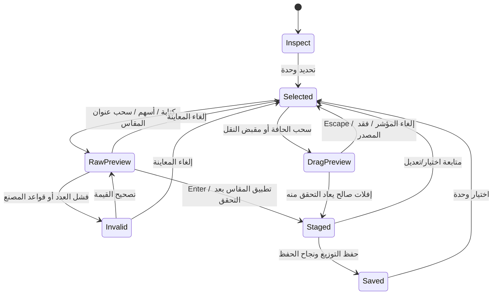

# دمج مساحة المصمم مع دفتر الموقع

تاريخ المواصفة: 2026-11-04. تصف هذه الوثيقة التنفيذ المدمج في مسار `whole`، وفق المصدر وقت الكتابة. حالات آلة التفاعل أدناه أسماء تفسيرية للمتغيرات والحراس الفعلية، وليست تعداد حالات جديدًا مخزنًا في المشروع. لا تتضمن الوثيقة ادعاء اختبار استخدام بشري أو تحسن مقاس تجريبي؛ نتائج الاختبارات الآلية ومراجعة المتصفح يسجلها تقرير التحقق المنفصل.

## الكائنات ومصدر الحقيقة

العلاقة التشغيلية: **مشروع ← جدار مرفوع ← صف تصنيع ← وحدة ← وصفة عائلة المصنع**. الصف الحر/الجزيرة يرتبط بالمشروع دون إلزامه بجدار؛ تعرض بطاقته مرجع قياسات الغرفة مع تمييزه كجزيرة.

| الكائن | الهوية والعلاقات | المسؤولية في الواجهة |
|---|---|---|
| المشروع | `room.projectId`، الغرفة، `kitchen`، `room.workshop` | أساس الحفظ والصلاحية وبصمة استعادة المسودة |
| الجدار | هوية من `roomArchitecture(room).walls`؛ سلسلة محفوظة في `workshop.chains[wallId]` | اختيار الواجهة، قراءة طول الجدار وحالة الرفع، فتح دفتر الموقع |
| صف المصنع | `run.id` في الرسم، و`workshop.rows[run.id]` | ترتيب الوحدات، المستوى السفلي/العلوي، تطابق إصدار الكتالوج |
| الوحدة | `unit.id` و`runId`؛ عضو مقابل بالهوية نفسها في وصف الصف | تحديد واحد متسق بين القائمة وSVG والمفتش؛ مقاس أو موضع قابل للتعديل بحسب القيود |
| وصفة المصنع | عائلة/`recipeId`، `catalogVersion`، مقاسات وخطوات وأقفال العضو | قبول المقاس، حفظ تطابق CAD مع وصف الصف، ثم حساب الأثر والقطع والسعر |

المقاسات المعروضة وحقول الصف بالملليمتر. أبعاد CAD المخزنة بالسنتيمتر: تحديث `startMm/widthMm` يقابله `u/width` بقسمة على 10. التحويل يحدث في دالة المجال، وليس في الديكور البصري.

**الرفع المحفوظ وتوثيقه مستقلان عن مسودة التصميم.** تستخدم أهلية جدران التصميم `surveyedDesignWalls`. تقرأ بطاقة الأساس `surveyNotebookSummary` من سلسلة المشروع، وتتحقق من تطابق التوثيق والقراءات وعناصر الرسم. هذه القراءة لا توقع سلسلة جديدة ولا تكتب `attestation`؛ الحفظ والتوثيق الفعليان يبقيان في دفتر الموقع ومساره الأصلي. اكتمال عرض التصميم أو حفظه لا يعني اعتماد التصنيع أو التسليم.

## تقسيم الواجهة

`decorateDesignerStudio` يقدم المتحكم الأصلي، ولا يملك نموذج مشروع أو سجل حفظ مستقلًا. قائمة اليمين تعرض كل الجدران وكل الوحدات، بما فيها الجزر، مرتبة حسب الجدار والمستوى والموضع. النقر على جدار متاح في التصميم يفتح واجهته؛ غير ذلك يفتح رفع ذلك الجدار. يبقى اختيار الوحدة الأصلي عبر `select` متاحًا.

الوسط يحتفظ بالمسقط والواجهة والمنظور، مقبضي العرض ومقبض ترتيب الوحدة، وأدوات الكاميرا. المفتش الأيسر يستضيف محرر المقاس أو لوحة التفاصيل/الخيارات القائمة وبطاقة أساس الرفع. تبقى أدوات البدائل والسعر والتقرير وبنود المراجعة والحفظ والاعتماد في مسارها الفعلي.

توضع `.ds-hud` شقيقة للـcanvas داخل `.ds-canvas-wrap` حتى لا تمحوها إعادة رسم SVG. موضعها مشتق من المقبض المحدد ومقيد بحدود الرسم؛ يتحدث عند الرسم وتغير الكاميرا وتغير حجم الحاوية. الديكور ينفذ مرة بعد كل بناء كامل للواجهة؛ تحديث الرسم اللاحق يعيد تموضع HUD فقط. CSS محصور في `.proposal-studio.designer-studio`، مع صف عمل محدود الارتفاع وقائمة وحدات ومفتش قابلين للتمرير الداخلي.

## ثلاث درجات مختلفة للتغيير

| الدرجة | الحالة الفعلية | ماذا يرى المصمم؟ | ماذا كُتب؟ |
|---|---|---|---|
| معاينة قيمة خام | `widthPreview` مع `raw/next/valid/source/part` | الرسم يقترح القيمة الصالحة مباشرة؛ عند الخطأ يبقى رسم المسودة وتظهر رسالة السبب | لا يتغير المشروع ولا سجل تعديلات المسودة؛ يمكن حفظ النص في سجل الاستعادة |
| تعديل مثبت في المسودة | عنصر في `histories[alternative]` و`s.applied=false` | الرسم ووصفة الصف والسعر/الأثر تستند إلى نتيجة التعديل المقبول | نسخة عمل محلية ووصفة استعادة؛ لا كتابة للمشروع حتى «حفظ التوزيع» |
| توزيع مطبق ومحفوظ | `s.applied` و`s.persisted` بعد نجاح المسار الأصلي | حالة الحفظ ثم إمكانية متابعة الاعتماد | `apply` عبر متحكم الورشة والمحرر و`commitProject`؛ سجل المشروع الأصلي |

القيمة الخام تمنع تغيير الوحدة أو البديل أو الإعدادات أو التراجع أو الحفظ حتى تطبيق المقاس أو إلغاء المعاينة. زر «تطبيق المقاس»/Enter يثبت في **المسودة**. زر «حفظ التوزيع» يكتب **المشروع**. الرسائل تذكر الفرق صراحة. عند فشل الكتابة لا تعني حالة التطبيق وحدها أن الحفظ نجح؛ يعتمد العرض على `persisted` ونتيجة المسار الأصلي.

## آلة التفاعل

حالة الوثيقة (`محفوظ`/`مسودة`/`قديم`/`جارٍ الحساب`) مستقلة عن التحديد والكاميرا. يمكن الرجوع من معاينة إلى المسودة السابقة أو المشروع المحفوظ بحسب أساسها، دون افتراض أن الإلغاء يحذف التعديلات المقبولة الأقدم.

| النمط | المحفز والفعل | القواعد | التغذية الراجعة | التكرار والنهاية | الإلغاء والاستعادة |
|---|---|---|---|---|---|
| استعراض/تحديد | نقر الوحدة أو اختيارها من القائمة؛ تحديد جزء أو عنصر موقع | هوية الوحدة الحالية، تصميم غير قديم؛ لا قيمة خام معلقة | تمييز متسق، مفتش وHUD؛ الجزء/عنصر الموقع يفتح لوحته | تبديل المنظر أو الوحدة؛ لا تعديل بالاختيار | Escape يزيل التحديد عند عدم تحرير حقل؛ الرجوع من صفحة فرعية يمكنه استعادة الوحدة والكاميرا للمشروع نفسه |
| كتابة المقاس | إدخال قيمة بالملليمتر، ثم Enter أو تطبيق المقاس | عدد صحيح آمن و`previewKitchenWidthChange`؛ تبقى هوية الوحدة ونسخة المصدر متطابقتين | معاينة حية للقيمة الصالحة؛ سبب رفض واضح دون تركيب هندسة مرفوضة | تصحيح متكرر ثم تثبيت واحد في سجل المسودة | «إلغاء المعاينة» أو Escape يعيدان المقاس المثبت السابق؛ النص الخام قابل للاستعادة بعد إعادة التحميل |
| ضبط دقيق | ↑/↓ داخل الحقل أو سحب عنوانه؛ Shift يضاعف الخطوة ×10 | الخطوة مشتقة من `snapFactoryWidthMm`؛ السحب يمر بمسار الإدخال نفسه | الحقل والرسم ورسالة المعاينة تتحدث معًا | الإفلات ينهي السحب فقط؛ يلزم تطبيق المقاس لتثبيته | إلغاء سحب العنوان يعيد النص الذي بدأ منه، حتى إذا كان نصًا خامًا غير مطبق؛ فقد التركيز أو التقاط المؤشر يلغي السحب |
| سحب العرض | سحب مقبض بداية/نهاية الوحدة | سماح تعديل العرض، خطوة المصنع، نسخة المصدر، القيود المكانية | معاينة أثناء الحركة؛ سبب المنع يبقي الرسم السابق | يعاد التحقق عند الإفلات؛ المقبول يصبح تعديلًا واحدًا في المسودة | Escape أو `pointercancel` أو فقد الالتقاط/الصلاحية يلغي؛ لا تحفظ حركة نصف مكتملة |
| إعادة ترتيب الصف | سحب المقبض الأوسط إلى أقرب وحدة على محور الصف، أو «قبل السابقة/بعد التالية» | الصف نفسه، جزء متصل، كل الوحدات المعبر عليها قابلة للنقل؛ قواعد المجال أدناه | معاينة ترتيب أو سبب منع؛ رسالة طرف الصف عند غياب جار | السحب يكرر المعاينة؛ الإفلات/الزر يثبت ترتيبًا واحدًا في المسودة | الإلغاء يعيد ترتيب الأساس؛ التراجع المحلي يعكس الترتيب المثبت |
| توليد/إعدادات | تغيير الجدران أو الوظائف ثم حساب البدائل | جدران مؤهلة؛ صلاحية تحرير؛ لا قيمة خام؛ المصدر لم يتغير | الرسم السابق للمراجعة عند اختلاف الإعدادات؛ تقدم أو سبب فشل الحساب | اختيار بديل ثم تعديلات؛ الإعدادات الجديدة تحتاج حسابًا مطابقًا | زر إلغاء الحساب يبطل نتيجته برقم `epoch`؛ يمكن استعادة اختيارات الرسم السابق إذا بقي المصدر نفسه |
| حفظ | «حفظ التوزيع» | `usable`، الصلاحية، لا معاينة خام، حارس الميزانية، ثم تحققات المشروع الأصلية | نتيجة حفظ أو سبب رفض؛ لا انتقال إلى اعتماد ناجح بالافتراض | النجاح يعيد أساس التعديل إلى نسخة المشروع المنظّمة المحفوظة ويمسح وصفة المسودة | الفشل لا يبرر التخلص من العمل؛ تستخدم الواجهة النتيجة ورسالة المسار الأصلي |
| تراجع/إعادة | أزرار الرأس أو Ctrl/Cmd+Z وCtrl/Cmd+Shift+Z / Y خارج الحقول | لا حساب أو سحب أو معاينة خام أو مصدر قديم؛ تحقق صلاحية | سجل المسودة أو سجل المشروع محدد نصيًا في الرأس | تعديل جديد يفرغ الإعادة المحلية؛ حفظ ناجح يعيد نقطة الأساس | المعاينة الخام تلغى أولًا؛ لا تستبدل اختصارات تحرير النص داخل الحقول |

## حدود الهندسة الفعلية

نقل الوحدة هو **إعادة ترتيب داخل الصف نفسه**، وليس نقلًا حرًا بين الجدران أو الصفوف. مثلًا `A,B,C,D` مع نقل `A` إلى موضع `C` يصبح `B,C,A,D`. يعاد رص الجزء المعبر عليه فقط؛ تبقى هويات الوحدات وعروضها وحدود ذلك الجزء وبيانات الاستخدام والوحدات غير المعنية كما هي.

يرفض النقل عبور فراغ مقصود، أو وحدة مثبتة الموضع، أو حيّز جهاز/مجلى محجوز. قفل العرض وحده لا يثبت موضع الوحدة. يلزم تطابق أعضاء وصف الصف مع الرسم، وإصدار الكتالوج والعائلة والمقاسات؛ ثم يجري فحص مجال التصميم والتعارضات الصلبة وأغلفة خيارات الجدار وإمكان فتح الواجهات. لا يسمح الديكور بتجاوز هذه الدوال.

تغيير العرض يحترم أقفال العرض والموضع والمقاسات القابلة للتسعير وخطوة العائلة؛ لا يستعير فراغًا مقصودًا أو حيّزًا محجوزًا. تعاد هندسة الرسم ووصف صف المصنع معًا ثم يحسب أثر التغيير. زرّا ± في المفتش يطلبان 100 مم، بينما الأسهم وسحب العنوان ومقابض الرسم تستخدم خطوة المصنع. كل طلب، أيًا كانت وسيلته، يخضع للتحقق نفسه.

لا تضيف هذه الواجهة أمر إنشاء/حذف وحدة حرًا؛ تظل العمليات التي تغير تكوين وصف المصنع ضمن تخصيص صف المصنع. تحرير قراءات عنصر الموقع ينتقل إلى دفتر الموقع، وتخصيص جزء الوحدة أو نشاط العميل يستعمل المسارات القائمة وحراس الحفظ الخاصة بها.

## السجل والاستعادة والصلاحيات

التراجع المحلي محفوظ في ذاكرة الجلسة لكل بديل: `histories` للمسار الحالي و`redos` لما جرى التراجع عنه. عند الرجوع تمامًا إلى الرسم المحفوظ قد تبقى إعادة تعديل المسودة متاحة، وتُعرض هذه الحالة في الرأس. رزم الإعادة المحلية ليست جزءًا من وصفة الاستعادة؛ يعاد فقط بناء مسار التعديلات الحالي.

بعد الحفظ تستخدم الأزرار `onHistory/canHistory` للوصول إلى `undoProject/redoProject`؛ لا ينشأ سجل مشروع موازٍ. سجل التراجع/الإعادة الأصلي محفوظ في `sessionStorage` بحد أقصى 25 لقطة وفق المساحة المتاحة؛ وهو سجل المشروع في جلسة المتصفح، لا سجل تدقيق سحابي دائم. كل انتقال يعيد الحفظ والتحقق والصلاحية، ثم يعيد فتح مساحة المصمم مع سياق الوحدة والمنظر.

مسودة التصميم في `localStorage` مستقلة بمفتاح النوع `design` ومعرّف المشروع. تكتب بعد مهلة 400ms، وعند إخفاء الصفحة أو المغادرة/التخلص من المتحكم، بشرط استمرار صلاحية التحرير. الوصفة تحتوي:

- بصمة `stableHash(savedProjectText())` للأساس، ونوعه `stored/generated`، وإعدادات التوليد، والبديل والمنظر.
- أوامر العرض `{part,delta,edge}` وأوامر النقل `{kind:'move',part,targetId}`؛ لا تحفظ معاينة سحب جارية.
- `rawWidth` للنص الذي لم يطبق، و`pendingSettings` للإعدادات المخالفة لإعدادات الرسم المحسوب.

الاستعادة تتطلب تطابق بصمة الأساس والصلاحية وشكل الوصفة. يفتح التصميم المحفوظ أو يعاد توليد التصميم، ثم تعاد الأوامر عبر دوال المجال ذاتها. يقرأ التنفيذ حتى 8 قوائم بدائل و40 أمرًا لكل قائمة، ويتوقف تسلسل القائمة عند أول أمر غير صالح؛ لذا الاستعادة المتاحة لا تعني ضمان إعادة كل وصفة تالفة أو تغيرت قواعدها. يستعاد النص الخام لوحدة قابلة لتعديل العرض، ثم تستعاد الإعدادات المعلقة إذا لم تبق معاينة خام. يطلب من المصمم مراجعة العمل قبل حفظه. اختيار التخلص الصريح من المسودة يمسح وصفة الاستعادة.

تتحقق الواجهة من `canEdit()` عند التوليد والتحرير والإفلات والسجل والكتابة والاستعادة. يلغي تغير كائن الأساس (`stale`) أو اختلاف الإعدادات أهلية تطبيق المقترح. طبقة الورشة تتحقق أيضًا من دور المستخدم وتجمد الوصول وتغير المشروع؛ و`commitProject` يرفض نسخة تغيرت في نافذة أخرى، ويعيد فحص الصلاحية والهندسة والسجلات قبل الحفظ. هذه طبقات تكامل مع نظام الصلاحيات الموجود؛ لم تُنشأ صلاحية أو مصادقة جديدة في الديكور.

حارس العمل غير المحفوظ يظل نشطًا للمعاينة الخام، وللعمل غير المطبق الذي تعذر تخزين وصفته. «محفوظ» هنا لا يلغي بوابات الاعتماد والإطلاق الأصلية، ولا يمنح التصميم توثيق رفع جديدًا.

## مصادر التنفيذ وحدود الإثبات

المراجع أدناه هي مصادر السلوك؛ أرقام الأسطر تخص المراجعة وقت كتابة الوثيقة وقد تتحرك مع تعديل الملفات.

| المصدر | نقاط الرجوع |
|---|---|
| [`public/kitchen-whole-plan-ui.js`](../../public/kitchen-whole-plan-ui.js) | الجلسة وحراس المصدر 36–58؛ الديكور 243–259؛ المعاينة/السجل 262–315؛ الحفظ 339–354؛ الإيماءات 552–642؛ الاستعادة 645–741 |
| [`public/kitchen-proposal-change.js`](../../public/kitchen-proposal-change.js) | الأهلية والخطوة 69–88؛ تحديث CAD ووصف المصنع 144–159؛ العرض 161–215؛ إعادة الترتيب 221–257 |
| [`public/kitchen-designer-studio.js`](../../public/kitchen-designer-studio.js) | ترتيب كائنات الواجهة ومرجع الرفع 9–35؛ تموضع HUD 37–47 |
| [`public/kitchen-designer-precision.js`](../../public/kitchen-designer-precision.js) | إدخال الأسهم، سحب التسمية، الإلغاء والعودة إلى النص السابق |
| [`public/kitchen-proposal-presentation.js`](../../public/kitchen-proposal-presentation.js) | هوية الوحدة وأهلية العرض/الموضع 35؛ مقابض العرض والنقل 91–101؛ الرسم التفاعلي مقابل التصدير 129–153 |
| [`public/kitchen-designer-studio.css`](../../public/kitchen-designer-studio.css) | العزل البصري، مناطق العمل المحدودة، التمرير، أحجام التحكم والاستجابة للشاشات |
| [`public/kitchen-survey-notebook-model.js`](../../public/kitchen-survey-notebook-model.js)، [`public/kitchen-chain-model.js`](../../public/kitchen-chain-model.js) | قراءة مصدر الرفع وصلاحية توثيقه؛ `attestChain` و`confirmedChainFeature` و`surveyedDesignWalls` |
| [`public/kitchen-workshop-ui.js`](../../public/kitchen-workshop-ui.js) | ربط السجل وحراس الدور/المصدر 226–238؛ تمرير صلاحية الصفحة 330–331 |
| [`public/kitchen-project.js`](../../public/kitchen-project.js)، [`public/kitchen-editor.js`](../../public/kitchen-editor.js) | سجل الجلسة 93–97؛ الحفظ والتحقق 198–222؛ الإعادة 256؛ مسار المحرر `travel` و`apply` |
| [`public/kitchen-draft-store.js`](../../public/kitchen-draft-store.js)، [`public/kitchen-unsaved-work.js`](../../public/kitchen-unsaved-work.js) | تخزين وصفة الاستعادة وحارس فقد العمل |

هذه مواصفة مصدرية للتنفيذ، وليست نتيجة دراسة ميدانية. لا تثبت وحدها جودة الاستخدام على جهاز لمس حقيقي أو سرعة إنجاز أو انخفاض أخطاء أو قبول المصممين. أسماء السيناريوهات ونتائج تشغيلها ولقطات المتصفح وحدودها تُسجل في تقرير التحقق؛ ولا تنقل هذه الوثيقة نجاحًا لم يُقَس.
