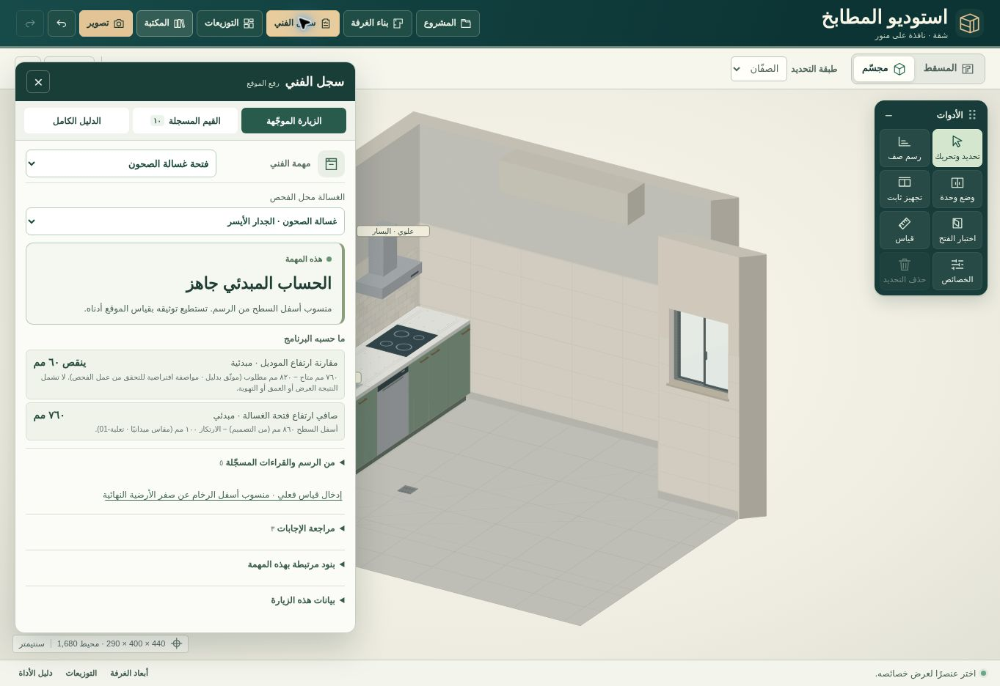

# الزيارة الموجّهة
يفتح سجل الفني على مهمة يختارها المستخدم أو يستدل عليها الاستوديو من الغسالة أو التجهيز المحدد في الرسم، ومن سياق الزيارة السابقة. لا يمرّ عبر القاموس الكامل. تظهر الأسئلة الحية وفق إجابات سابقة، مع مراجعها وخيار «لا أعرف الآن». تبقى المدخلات اليدوية متاحة من الدليل الكامل، ويمكن تحديد بيانات الزيارة مرة في التبويب للقراءات الجديدة.

## أمثلة تم اختبارها
- تغيير العرض الداخلي فقط من 4300 إلى 4400 مم، مع تأكيد الفني للعمق والارتفاع وحدود المنور الأخرى: مساحة الغرفة بعد الرفع 16.65 م². يظهر اقتراح صريح لتحديث الرسم ويتحقق من تعارضاته ويُتراجع عنه مرة واحدة. لا تعدَّل هندسة الغرفة عند مجرد تسجيل القراءة.
- غسالة عند تعلية مسجّلة 100 مم، ومنسوب أسفل الرخام في الرسم 860 مم، ومطلوب فتحة الموديل 820 مم. بعد تحديد موضع الارتكاز من القراءات المحفوظة: المتاح 760 مم؛ ينقص 60 مم. النتيجة مبدئية طالما أُخذ أسفل السطح من التصميم فقط. تراجع حالة الأرجل على مستويين مستقلًا، ولا يفترض ارتفاع صفر عند فقدان قياس.
- طلب 20 كجم من الأرز بالأكياس الأصلية ذات 5 كجم: 4 أكياس، ولا يطلب البرنامج مواصفات عيّاشة. المقاسات المطلوبة لعتاد الركن ليست أسئلة إلزامية لمن اختار رفوفًا ثابتة.
- يبقى قالب سطح العمل مؤجّلًا قبل تثبيت الوحدات وتسويتها. لا يعني انتهاء أسئلة المهمة اعتماد التصنيع.
- ترتبط القيم بالعنصر الفعلي ووحدته بما فيها تحويل سم إلى مم، ويُعرض تعارض القراءات للمراجعة بدل التخمين. تُعاد الحسابات من المصدر عند تغيير الإجابات؛ لا تسجَّل نتيجة الحساب كأنها قراءة جهاز قياس.

