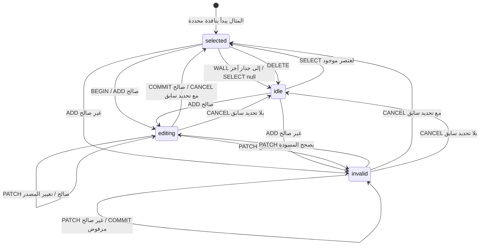
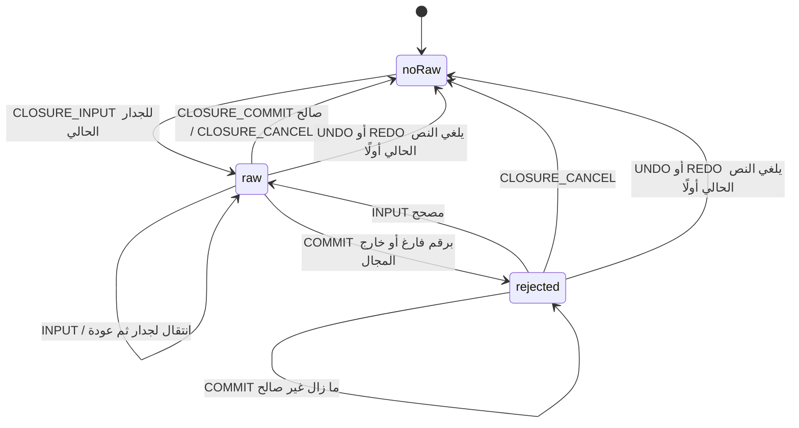

# بنية التفاعل — استوديو المطابخ

تاريخ التصميم: ٣ نوفمبر ٢٠٢٦؛ مطابقة التنفيذ: ٤ نوفمبر ٢٠٢٦. نطاق النموذج الأولي المختار: رفع الفني للموقع والقياسات. تفصل هذه الوثيقة السلوك المنفذ عن تصميم المسار الكامل وخطة دمجه؛ ليست تقرير تجربة مستخدمين أو إثبات جاهزية إنتاجية.

> تحديث ٤ نوفمبر ٢٠٢٦: دُمجت لغة «دفتر الموقع» في المسار الفعلي فوق عقود المشروع القائمة. مرجع التنفيذ الحالي هو [مواصفة الدمج](survey-notebook-integration.md) و[تقرير التحقق](survey-notebook-review/REPORT.md). تبقى تفاصيل النموذج المعزول أدناه سجلًا استكشافيًا؛ لم تُنقل مخططاته التجريبية أو تأكيداته إلى بيانات المشروع.

## ما نعرفه وما نختبره

- **دليل من المصدر:** للمشروع غرفة وتصميم، وللجدار سلسلة رفع، وللعنصر قراءات ومراجع. الرسم مخزّن بالسنتيمتر، والرفع يستقبل الملليمتر. الرفع المعتمد والتصميم واعتماد العميل والإفراج مفاهيم مستقلة. تفاصيل المصادر في آخر الوثيقة.
- **قرار تصميم لهذه التجربة:** مساحة مكانية ثابتة لواجهة الجدار، مع لوحة سياقية وحقول دقيقة بجوار العنصر المحدد. المدخل هو الشيء الذي يعمل عليه الفني، ثم الفعل الذي يحتاجه.
- **فرضيات تحتاج اختبارًا:** سيقل الانتقال بين الرسم والنموذج، وسيفهم الفني مرجع القياس وحالة مصدره بصورة أفضل، وسيكتشف أخطاء المركز/الحافة مبكرًا. لم تُقَس هذه النتائج.
- **حدود المعرفة:** تحليل المهام مستنتج من الكود والوثائق؛ لا توجد مقابلات أو ملاحظات ميدانية جديدة تدعم تواتر المهام أو أزمنتها. بروتوكول اختبار هذه الفرضيات في `survey-usability-protocol.md`.

## خريطة الأشياء والعلاقات — OOUX

### نطاق الرفع

| الشيء | ما يميزه | علاقاته | الأفعال الأساسية |
|---|---|---|---|
| المشروع/الموقع | اسم وهوية وغرفة ونسخة | يحتوي الجدران والتصميم والسجل | فتح، متابعة، حفظ نسخة |
| الغرفة | حدود داخلية بعد التشطيب وارتفاع | تُشتق منها الجدران؛ تحتوي نقاط الأرضية | قياس الحدود، مراجعة المسقط |
| الجدار | هوية وبداية واتجاه وطول وارتفاع | يملك سلسلة رفع؛ يستضيف عناصر الموقع | اختيار، تنقل، مراجعة الإغلاق |
| فتحة أو عنصر ثابت | نوع وهوية وموضع وأبعاد | يرتبط بجدار وقراءة؛ قد يتعارض معه التصميم | إضافة، تحديد، قياس، نقل، حذف |
| خدمة | نوع ومركز أفقي ورأسي | ترتبط بالجدار أو الأرضية وبقياسها | وضع المركز، تصحيح الموضع، توثيق |
| قراءة | قيمة ووحدة وخاصية ومرجع وحالة تحقق | تخص عنصرًا؛ قد تنافس قراءة أخرى | إدخال، مراجعة، تأجيل، حسم تعارض |
| دليل | مصدر أو مرجع أو صورة/مستند | يسند قراءة؛ لا يستبدل القياس تلقائيًا | ربط، فتح، وصف |
| تأكيد رفع الجدار | اسم الفني ومرجع وتاريخ وبصمة | يغطي هندسة وسلسلة محددتين | تأكيد، اكتشاف تقادم، إعادة مراجعة |
| مشكلة | سبب ونطاق وعناصر متأثرة | تربط القراءة أو التصميم بموضع قابل للفحص | الانتقال للسبب، التصحيح، إعادة التحقق |

تبقى هوية العنصر نفسها عند التنقل بين الرسم واللوحة وسجل القراءة. لا تتحول كل خاصية أو زر إلى «شيء» مستقل. تظهر الأدلة والقراءات التابعة عند الحاجة، مع بقاء أصل القياس مرئيًا أثناء التحرير.

### النظام الكامل

| سلسلة العلاقات | مسؤولية التفاعل |
|---|---|
| المشروع ← الغرفة ← الجدران ← الرفع والأدلة | فهم الموقع وما هو مقاس وما يزال مطلوبًا |
| المشروع ← طلب العميل ← توزيع مقترح ← صفوف ← وحدات | اختيار التصميم وتخصيصه مع المحافظة على حقائق الموقع |
| الوحدة ← وصفة المصنع ← قطع ← أصناف المتجر | فهم قابلية البناء والكميات ومصدر المواصفة |
| الوحدات/القطع ← تشطيبات وعتاد وأجهزة | معاينة الاختيار والتحقق من الملاءمة |
| الحصر + أسعار الشراء + شروط التسعير ← عرض العميل | بيان المكتمل والمجهول والأثر المالي للتعديل |
| إصدار التصميم ← موافقة العميل ← إفراج محفوظ ← أمر/دفعة ← فحص وتسليم | ربط كل إجراء بالنسخة والنطاق اللذين يغطيهما |

تظل `storeCatalog` و`factoryRecipes` و`pricingTerms` سجلات محفوظة باعتمادات مستقلة؛ `catalog` عرض مركب للحسابات. المكتبات تعطي المشروع نسخة من السجل؛ ليست روابط حية تتغير دون مراجعة. البوابات المهنية مفيدة للوصول إلى الأعمال العامة، بينما يبدأ التحرير اليومي من الشيء المحدد والمشكلة الحالية.

## تحليل المهام والنماذج الذهنية

الأولويات الآتية **ترتيب تصميم مقترح** بحسب أثر الخطأ وترابط العمل، وليست بيانات تكرار مقاسة.

| الأولوية | المهمة وشرط البداية | النهاية ذات المعنى | النموذج الذهني الذي نخدمه |
|---|---|---|---|
| P0 | معرفة الجدار وأصل القياس قبل الإدخال | الفني يستطيع الإشارة إلى الجدار والركن واتجاه الزيادة | «أنا واقف أمام هذا الجدار» |
| P0 | تسجيل فتحة أو خدمة من قياس فعلي | قيمة ووحدة ومرجع صحيح، والعنصر ظاهر في موضعه | «المسافة من هنا إلى الإطار/المركز» |
| P0 | تصحيح قياس دون إفساد الجوار | العنصر المقصود تغير والجوار بقي في محطاته الصحيحة | «أصحح هذه القراءة فقط» |
| P0 | مواجهة قيمة غير صالحة أو متعارضة | سبب محدد وعودة إلى آخر حالة صالحة أو تصحيح واضح | «المقاس لا يركب؛ أين الخطأ؟» |
| P0 | مراجعة الإغلاق والمصدر والتأكيد | يعرف الفني ما تمت مراجعته وما بقي مجهولًا | «هل أستطيع تسليم رفع هذا الجدار؟» |
| P1 | إضافة وحذف عنصر والتراجع | تغيير واحد مفهوم ويمكن عكسه | «أجرب ثم أرجع» |
| P1 | التنقل بين الجدران ومراجعة النواقص | يستأنف عند العنصر/القراءة نفسها | «أمشي حول الغرفة» |
| P2 | الانتقال من الرفع إلى التصميم ثم الإنتاج | تنتقل الأدلة والهوية والحالات دون اعتماد ضمني | «هذه القياسات أساس العمل التالي» |

هناك نموذجان مشروعان للمسافة: شريط قياس متتابع من العنصر السابق، ومحطة مطلقة من ركن البداية. يجب تسمية المرجع وعدم تبديله ضمنيًا أثناء السحب. اللغة العربية RTL تنظّم النص؛ لا تعكس النظام الهندسي أو اتجاه الجدار تلقائيًا.

## البدائل وقرار الواجهة

| البديل | القيمة | القيد | القرار |
|---|---|---|---|
| معالج كامل أو نموذج طويل | ترتيب أسئلة واضح وحقول صريحة | فصل متكرر بين القراءة وموضعها؛ صعوبة الرجوع إلى عنصر بعينه | يبقى مناسبًا لمهام متخصصة، وليس الهيكل الرئيسي للتجربة |
| مساحة مكانية ولوحة سياقية | الشيء وقياسه ونتيجة التعديل في سياق واحد | يحتاج وضوح التحديد والمرجع وحدود العرض | **البديل المختار بقرار التصميم في هذه المهمة** |
| إيماءات فقط | مساحة رسم واسعة وتفاعل مباشر | ضعف الاكتشاف والدقة وبدائل لوحة المفاتيح | مرفوض كأساس؛ الإيماءة اختصار إلى جانب حقول وأزرار صريحة |

يُحافظ على التحديد عبر الرسم واللوحة. تعرض الطبقة القريبة من العنصر المقاسات المهمة فقط؛ تُفتح التفاصيل والأدلة في اللوحة السياقية. تبقى الإضافة والحذف والتراجع وأسلوب الإلغاء قابلة للاكتشاف دون حفظ إيماءات.

## لغة بصرية وحركة دلالية

لوحة الألوان المقترحة: خلفية كريمية `#F5F0E6`، حبر داكن `#23332F`، أخضر مزرق `#246C63` للتحديد والفعل الأساسي، كهرماني `#A36516` للمراجعة، وأحمر `#B63F36` للتعارض. هذه قيم تصميم أولية؛ تُفحص قابلية القراءة فعليًا قبل اعتمادها.

- النص والحافة والرمز تحمل الحالة مع اللون: «محدد»، «مسودة»، «يحتاج مراجعة»، «تعارض»، «تمت مراجعة التجربة». اللون وحده لا يقرر المعنى.
- خط القياس يوضح نقطتي المرجع، ومركز الخدمة مميز عن حافة الفتحة. تبدو المسودة شفافة مع حد متقطع، ويظل الأصل قابلًا للمقارنة.
- تفسّر الحركة ما تغير: انتقال العنصر وتحديث خطه، إبراز الحد المرفوض، وعودة آخر حالة صالحة. لا تستخدم حركة زخرفية أثناء إدخال رقم دقيق.
- لا تؤخّر الحركة ظهور خطأ أو قبول قيمة. تُراعى الحركة المخفضة؛ تكون التحولات الفورية كافية لفهم الحالة.
- تظهر الوحدات والمراجع مع الرقم، وتُستخدم معالجة اتجاه مناسبة للأرقام والمعرفات داخل النص العربي. يحتفظ التركيز بلوحة المفاتيح بمعنى ظاهر بعد التحديث.

## الدقة ومصدر الحقيقة

1. يحفظ CAD حافة العنصر القريبة وأسفله بالسنتيمتر. تعرض تجربة الرفع الملليمتر؛ تستخدم التحويلات القائمة بدل ضرب الإحداثيات على نحو عام.
2. الفتحة تُقاس إلى الإطار الخارجي. المياه والصرف والتهوية والغاز والكهرباء تُقاس عند المركز أفقيًا ورأسيًا. «منسوب المركز» يختلف عن «منسوب أسفل الإطار».
3. الأصل هو بداية ضلع الجدار الفعلي بعد التشطيب. المناسيب الرأسية من الأرضية النهائية. ظهور النص من اليمين لا يغيّر الأصل.
4. قياس الزاوية/الإغلاق قراءة ميدانية مستقلة؛ لا يُستنتج من النقر على طرف الرسم. `resolveChain` يختبر الإغلاق وحدود الجدار والسقف وبنية التسلسل.
5. الصفر قيمة؛ المجهول و«لا ينطبق» حالتان. القيمة المفترضة أو المسحوبة من الرسم لا تصبح قراءة موثقة لمجرد أن هندستها صالحة.
6. الرسم المرشح لا يغيّر القراءات المحفوظة حتى التثبيت. المعاينة الحية تعني إعادة حساب المرشح وعرضه، لا حفظ كل حركة مؤشر.
7. لا يُخفى التعارض بتغيير القياس الصحيح. قد يكشف رفع جديد أن تصميمًا قائمًا يحتاج نقل وحدة.

## دورة التفاعل والحالات

الحالات المنفذة في `public/survey-studio-model.js` هي `idle` و`selected` و`editing` و`invalid`. التثبيت فعل ينتهي بالعودة إلى التحديد؛ ليس حالة `committed` إضافية. لا توجد حالة `stale` في التجربة ذات الذاكرة المحلية؛ اكتشاف تغير المشروع في نافذة أخرى من متطلبات الدمج المستقبلي. حالة المصدر ومراجعة الجدار ومسودة الإغلاق محاور مستقلة عن `phase`.

`SELECT/WALL/ADD/BEGIN` لا تستبدل مسودة قراءة قائمة؛ تُرفض مع توجيه للتثبيت أو الإلغاء. رفض إجراء لا يحوّل مسودة صالحة إلى `invalid`. يغيّر تعديل أي بُعد المصدر إلى `unknown` حتى يختاره المستخدم من جديد، ويُلغي التثبيت المؤثر مراجعة الجدار السابقة. يعيد التاريخ اللقطة والتحديد ثم يشتق `idle/selected`.

### مسودة الإغلاق محور مستقل لكل جدار

`closureDrafts[wallId]` تحتفظ بالنص الخام، بما فيه النص غير الصالح، عبر التنقل بين الجدران. لا تدخل هذه الخريطة في لقطات التاريخ؛ تسجل القراءة المقبولة في `wall.closureMm`. وجود مسودة إغلاق يمنع تأكيد جدارها، لكنه لا يفرض حالة `editing` على العنصر ولا يمنع الانتقال إلى جدار آخر. تمنع مسودة العنصر القائمة بدء تحرير الإغلاق أو تثبيت بيانات الجدار.

الصلاحية العددية هنا تعني أكثر من صفر وحتى ١٨٠٠٠ مم. يمكن تسجيل قراءة ضمن المجال تختلف عن طول الجدار؛ يبقى فرق أكثر من ٠٫٥ مم مانعًا للمراجعة، بدل حذف القراءة أو إخفاء الفرق. عند `UNDO/REDO` يكون الترتيب: إلغاء مسودة الإغلاق للجدار الحالي، ثم إلغاء مسودة العنصر، ثم السفر في التاريخ. نصوص الإغلاق الخام للجدران الأخرى تبقى محفوظة في ذاكرة الجلسة.

الجدار الخالي يحتاج `emptyReviewed=true` بإجراء صريح، إضافة إلى مراجعة الأبعاد والإغلاق. لا يكفي غياب الصفوف لاستنتاج أن الفني بحث عن الفتحات والخدمات. إضافة/تغيير سلسلة أو حذف عنصر يصفر هذه الإفادة، ولا يقبل النظام وضعها لجدار يحتوي عناصر. هذا تحقق محلي في التجربة، وليس إفادة ميدانية معتمدة.

الجدول التالي يصف **السلوك المنفذ المقروء من المصدر**، ولا يثبت نجاحه مع فنيين أو على جهاز لمس حقيقي.

| التفاعل | Trigger — المشغّل | Action — الفعل | Rules — القواعد | Feedback — التغذية الراجعة | Loops — التكرار | End — النهاية | Recovery — الاستعادة |
|---|---|---|---|---|---|---|---|
| التحديد | نقر العنصر/القائمة؛ Enter أو Space على عنصر الرسم | ربط العنصر والحقول وخط القياس | يرفض تغيير التحديد أو الجدار مع مسودة عنصر قائمة | حد واضح واسم ومرجع | اختيار عنصر آخر بعد تثبيت/إلغاء | `selected`؛ تغيير الجدار ينتهي بـ`idle` | `Escape` يلغي المسودة ولا يزيل التحديد؛ المساحة الخالية لا تنشئ فعلًا |
| إدخال رقم | تركيز حقل وتغيير القيمة | بناء مرشح وإعادة الحل | تحليل عربي؛ وحدة ومرجع صريحان؛ لا تحويل الفراغ إلى صفر | نتيجة حية أو سبب قرب الحقل | تصحيح حتى الصلاحية | تثبيت واحد عند إجراء صريح | إلغاء القيمة/عودة اللقطة؛ لا تاريخ لكل حرف |
| سحب قيمة رقميًا — scrub | سحب اسم الحقل بعد عتبة حركة ٥ بكسلات | معاينة القيمة بخطوة ١ مم لكل بكسل، أو ٠٫١ مع Shift | يبقى الإدخال الرقمي بديلًا؛ يتغير المصدر إلى مجهول | الرقم والخط يتحدثان؛ آخر موضع صالح عند الرفض | سحب ثم ضبط | الإفلات يبقي مسودة؛ «تثبيت القراءة» هو الحفظ المحلي | `Escape` أو انقطاع الإيماءة يعيد حالة ما قبل السحب |
| نقل/تحجيم عنصر | سحب الجسم أو مقبض العرض/الارتفاع | تعديل المحطة والمنسوب أو الحجم | الجدار نفسه؛ مركز الخدمة؛ صفوف المثال من الأصل مستقلًا | المعاينة والحقول؛ آخر رسم صالح إذا فشل الحل | إعادة التموضع/التحجيم | مسودة تحتاج تثبيتًا صريحًا | إلغاء السحب يعيد حالته السابقة؛ إلغاء التحرير يعيد القراءة المثبتة |
| إضافة | زر نافذة/باب/مياه/كهرباء/صرف | مسودة عند منتصف الجدار بقيم أولية وهوية فريدة | المصدر مجهول؛ حدود الجدار والسلسلة؛ لا رسم حر للإضافة في النسخة الحالية | شكل مرشح وحقول لازمة | تعديل الرقم أو سحب المسودة | COMMIT يضيف عنصرًا واحدًا | إلغاء المسودة؛ لا عنصر مثبت قبل القبول |
| حذف | زر حذف لعنصر محدد | حذف الصف ومصدره المحلي | يرفض أثناء مسودة؛ يصفر مراجعة الجدار وإفادة الخلو | رسالة وإمكان التراجع | حذف آخر بإجراء مستقل | إزالة واحدة في التاريخ | تراجع يعيد الصف والمصدر وحالة اللقطة |
| تأكيد التجربة | زر مراجعة واضح | مراجعة الحالة التجريبية الحالية | ليست `attestChain`؛ لا اعتماد ميداني أو تصنيع | عبارة «مراجعة داخل التجربة» ونواقص محددة | تصحيح ثم إعادة المراجعة | حالة مراجعة محلية فقط | أي تعديل مؤثر يعيد الحاجة للمراجعة |
| التاريخ | تراجع/إعادة بزر أو اختصار | إلغاء النص الحالي ثم المسودة ثم استعادة لقطة | الأولوية لمسودة إغلاق الجدار الحالي؛ تثبيت جديد يقطع الإعادة | وصف الإلغاء أو التراجع والتحديد الناتج | تراجع/إعادة متتابعة | لقطة الغرفة والجدران والتحديد | نصوص إغلاق الجدران الأخرى خارج اللقطات؛ لا محفوظات مشروع حقيقي |

## حدود النموذج الأولي وخريطة مصدره

مدخل التجربة المنفذ `public/survey-studio.html`؛ انتقالات الحالة في `public/survey-studio-model.js` وربط الواجهة والإيماءات في `public/survey-studio.js`. يستعمل عرض الجدار القائم `surveyWallSheet` من `public/kitchen-survey-wall-sheet.js`، وحل القياسات `resolveChain` من `public/kitchen-chain-model.js`. الرسم والحساب من مجال التطبيق؛ غلاف التفاعل والحالات المحيطة تجربة معزولة.

خريطة مصدر كل صف في التجربة **بيانات تجريبية مرافقة للصفوف** لشرح الفرق بين المقاس والمستنتج والمطلوب. ليست حقلًا قائمًا في مخطط سلسلة الإنتاج. مخطط الإنتاج الحالي يضع `source` على السلسلة؛ سجل الفني يملك حالات ومصادر مستقلة للقراءات. لا يُحقن تمثيل التجربة في JSON إنتاجي ولا تُعدّل دوال التنظيف لقبوله ضمن هذه المهمة.

«تأكيد» التجربة يراجع نسخة العرض المحلية؛ لا يستدعي `attestChain`، ولا ينشئ اسم فني أو مرجع رفع أو بصمة اعتماد حقيقية. لا تغير التجربة المشاريع المحفوظة أو صلاحيات الحساب أو المزامنة أو الإفراج أو المخزون. لا تعني حالة العرض «تم الحفظ في المشروع».

الجلسة في الذاكرة فقط؛ إعادة التحميل تبدأ المثال من جديد. الفعل الخارجي الوحيد هنا تنزيل `survey-experiment.json` الذي يضم حالة التجربة وسجل الأحداث ويحذف مكدسي التاريخ، مع تنبيه صريح بأنه ليس مشروعًا إنتاجيًا أو اعتمادًا ميدانيًا. لا يوجد استيراد لإعادة جلسة من هذا الملف، أو إرفاق صور/مستندات، أو حفظ سحابي. خريطة المصادر قائمة اختيارات محاكاة، وليست فحص دليل فعلي.

التحقق الهندسي الحالي من `resolveChain` يغطي بنية السلسلة وحدود الجدار والسقف والمراجع؛ والإغلاق المحلي يتحقق منه `blockers`. **لا تتضمن التجربة تحققًا عامًا لكل زوج من العناصر من التداخل**؛ فقد يمر تراكب نافذتين إذا بقيتا داخل الحدود. لا يُسوّق نجاح الحل بوصفه كشفًا شاملًا للتعارض أو ملاءمة تركيب.

الغرفة ثابتة في التجربة: ٤٢٠٠ × ٣٦٠٠ مم وارتفاع ٢٨٠٠ مم. يبدأ الجدار الخلفي بنافذة مرجعها ١٥٠٠ مم وعرضها ١٢٠٠ مم وأسفلها ١١٠٠ مم وارتفاعها ٩٠٠ مم، ومياه مركزها ٩٠٠/٥٥٠ مم، وكهرباء مركزها ٣١٠٠/١١٥٠ مم. المصادر الأولية من الرسم، ولا توجد قراءة إغلاق أو مراجعة ميدانية مثبتة. تحرير الغرفة وإدارة الأدلة من خارطة الدمج المستقبلية.

لم تُجرَ دراسة بشرية أو تجربة على جهاز لمس حقيقي ضمن توثيق هذه النسخة. دعم أحداث المؤشر وتصميم عرض ضيق لا يثبتان نجاح اللمس. تُراجع الأدلة التقنية وحدودها في [سجل تحقق التجربة](interaction-review/REPORT.md) عند اكتماله؛ لا تُستنتج منه أزمنة فنيين أو سهولة استخدام مقاسة.

الحفظ الفعلي عند الدمج يمر من `commitProject` لا من كتابة مباشرة. السحابة تفحص النسخة والصلاحيات، والإفراج مرتبط بلقطة محفوظة وإيصال؛ لا تمنح تجربة واجهة هذه الصلاحيات.

## خارطة الدمج إلى المسار الكامل

المرحلة الأولى فقط لها تنفيذ تجريبي حالي بالحدود السابقة؛ المراحل التالية عمل مستقبلي. لا تعني كلمة «ربط» أنه تم بالفعل، ولا توسّع حالة تأكيد التجربة إلى أي مرحلة إنتاجية.

| المرحلة | العمل | شرط الانتقال |
|---|---|---|
| ١ — عقد التجربة | تثبيت الأشياء والمرجع والأفعال، وفحص المسارات المحلية والحدود | توافق السلوك الموثق والمنفذ؛ عدم مساس ببيانات حقيقية |
| ٢ — تجربة الفني | مقارنة الواجهة الأساسية بالمساحة المقترحة وفق البروتوكول | أدلة فعلية على الفهم والدقة؛ معالجة الأخطاء الحرجة |
| ٣ — مصدر القراءة والحفظ | ربط سجل الفني والأدلة، واعتماد نموذج واضح لمصدر الصف، ثم `commitProject` والتراجع والحفظ المتعذر | قراءة/حفظ/إعادة فتح سليمة؛ لا رفع لحالة الدليل ضمنيًا |
| ٤ — تأكيد الجدار | ربط `attestChain` والتحقق من تقادم الهندسة والمصدر وإغلاق الجدار | التأكيد يغطي النسخة الصحيحة؛ التعديل يعيد المراجعة المطلوبة |
| ٥ — التسليم للتصميم | نقل التحديد والمشكلة والمرجع إلى الصفوف والوحدات؛ عرض أثر الرفع الجديد | الحفاظ على الحقيقة الميدانية والهوية والقيود في الانتقال |
| ٦ — التشطيب والحصر | استخدام النمط السياقي للوحدة والخامة والوصفة؛ معاينة الأثر الهندسي والمالي | بقاء السجلات الثلاثة واعتماداتها مستقلة، والمجهول ظاهرًا |
| ٧ — العميل والإنتاج | مراجعة نسخة العميل والتعديل ثم نطاق الإفراج والدفعات والاستلام | استعمال عقود الخادم والإيصالات القائمة؛ صلاحيات وحالات متزامنة مثبتة |
| ٨ — تعميم الواجهة | اختبار أحجام العرض ولوحة المفاتيح والحركة والأداء والأدوار | قبول موثق لكل رحلة؛ لا تعميم من نجاح رحلة رفع واحدة |

## المصادر الدقيقة وحدودها

المسارات التالية نسبية إلى `C:\Users\Bakheet\Projects\Kitchen-Studio`. أرقام الأسطر هي مواضع التدقيق في ٣–٤ نوفمبر ٢٠٢٦، وليست تعهدًا بثباتها بعد التعديل.

- `public/survey-studio-model.js:1–35,54–74,124–240` — بيانات المثال، موانع التأكيد، حالات التفاعل، `emptyReviewed`، ومسودات الإغلاق والتاريخ.
- `public/survey-studio.js:55–70,143–197,200–262` — المعاينة، ربط الأفعال والإغلاق، التصدير، لوحة المفاتيح، والإيماءات التي لا تثبت تلقائيًا.
- `public/survey-studio.html:34,46` — الأنواع المعروضة وحدود الجلسة المعلنة في المساعدة.

- `README.md:4–7` — الوحدات والحفظ والتمييز بين التقدير والموافقة والإفراج.
- `docs/kitchen-studio/saudi-room-survey.md:2–16` — المقاسات الداخلية، مرجع الجدار، نطاق الغرفة والقيود.
- `docs/kitchen-studio/technician-register.md:4–6` — أنواع القراءات والمصدر والمجهول والمرفقات وحدود الفحص.
- `docs/kitchen-studio/guided-visit.md:5–9` — تسجيل القراءة مقابل تطبيق الرسم وحدود إتمام المهمة.
- `docs/kitchen-studio/gateways.md:41–59`، `public/kitchen-catalog-records.js:5–9,94–124` — السجلات والاعتمادات المستقلة.
- `docs/kitchen-studio/libraries.md:3–6` — النسخ إلى المشروع والحفظ المحلي للمكتبات.
- `public/kitchen-model.js:7–8,589–615` — وحدات الرسم ومرجعه والفصل بين الرفع والتصميم.
- `public/kitchen-chain-model.js:24–26,97–151` — مرجع الفتحات والخدمات، حل السلسلة، الإغلاق والتأكيد.
- `public/kitchen-measurement-identity.js:4–8` — تحليل الأرقام وتحويل الوحدات.
- `public/kitchen-cad-measurement.js:9–19,24–63` — تحويل الأبعاد وتصحيح العنصر مع صون الجوار.
- `public/kitchen-wall-ink-model.js:2–3,57–174` — مسودة بلا تخزين، حقول مستنتجة، تقادم الأصل والتثبيت.
- `public/kitchen-field-model.js:9–17,57–63,80–87` — حالات القراءة والتحقق والإدخال.
- `public/kitchen-assist-engine.js:35–49,110–125` — التعارض والدليل وتطبيق الرسم الصريح.
- `public/kitchen-survey-wall-sheet.js:43,125–126,196` — واجهة العرض وعناصر الاختيار ومرجع الملليمتر.
- `public/kitchen-project.js:124–133,197–221` — تعارض النوافذ، التحقق والحفظ والتراجع.
- `public/kitchen-workshop-state.js:156–164,182–214`، `app/api/projects/route.ts:113–140` — تبعية الاعتماد والإفراج للنسخة والقيود.
- `lib/project-revisions.ts:4–6` و`public/kitchen-access-policy.js:12–13` — الأدوار الحالية؛ وصف `owner/editor` فقط في وثيقة البوابات أقدم من المصدر الحالي.

المواصفة لا تدعي أن قراءة المصدر تثبت قابلية الاستخدام أو أن النموذج الأولي يغطي الاختبارات الإنتاجية المذكورة في وثائق أخرى.
