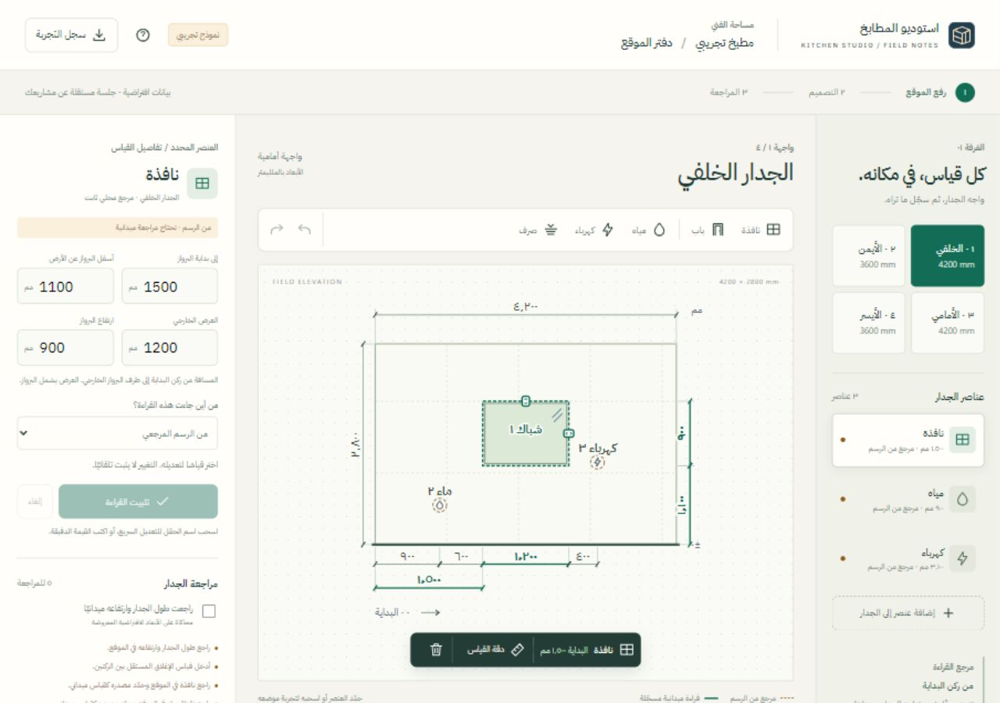
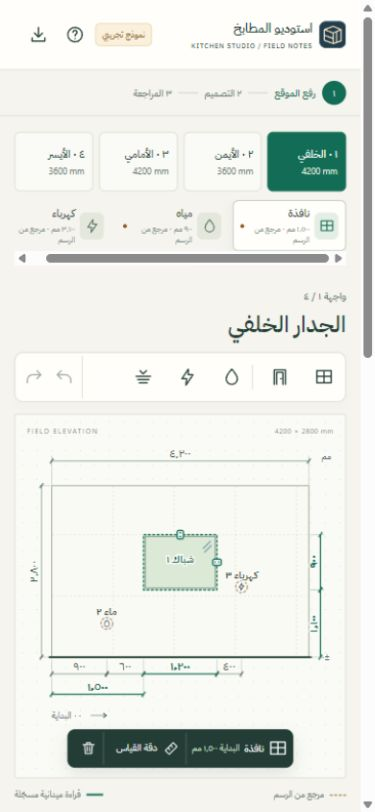

# تحقق نموذج دفتر الموقع

تاريخ الإكمال: ٤ نوفمبر ٢٠٢٦، بتوقيت الرياض. نطاق التنفيذ: نموذج تفاعلي لمسار الفني في رفع الموقع والقياسات، ومواصفة لمعمارية التفاعل وخطة دراسة مستخدمين. هذه نتائج تحقق تقني داخل المتصفح؛ لم يشارك فيها فنيون أو مستخدمون بشريون.

## فتح النموذج

- المسار: `public/survey-studio.html`.
- المعاينة المحلية أثناء التسليم: `http://127.0.0.1:8765/survey-studio.html`.
- لإعادة التشغيل من جذر المشروع: `py -m http.server 8765 --bind 127.0.0.1 --directory public` ثم افتح الرابط السابق. تشغيل الواجهة الإنتاجية والخادم الكامل له تعليمات مستقلة في README.
- الجلسة في الذاكرة فقط. إعادة تحميل الصفحة تبدأ المثال من جديد. زر «سجل التجربة» ينزّل JSON موسومًا `kitchen-survey-interaction-prototype`؛ ليس ملف مشروع أو اعتمادًا، ولا يرسله إلى خادم.

## المنفذ

غرفة تجريبية بأربعة جدران، واجهة أمامية مشتقة من `surveyWallSheet` القائم، وتحقق القياسات بواسطة `resolveChain`. غلاف جديد عربي RTL يتضمن قائمة كائنات، أدوات إضافة ظاهرة، HUD يتبع المحطة أفقيًا، وحقول دقيقة متصلة بالعنصر. الفتحات تستخدم البرواز الخارجي؛ الخدمات تستخدم المركز. الحقول الفارغة لا تتحول إلى صفر.

آلة حالة نقية تفصل المسودة عن القراءة المثبتة والتأكيد المحلي. تغيير الهندسة يعيد مصدر القراءة إلى مجهول، والتثبيت المؤثر يلغي تأكيد الجدار. السحب والتحجيم والإدخال العددي تنتج مسودة واحدة؛ الإفلات لا يثبتها. يدعم التراجع والإعادة والإلغاء وحراسة الانتقال عند وجود مسودة عنصر.

مسودات الإغلاق تحتفظ بالنص الخام لكل جدار عبر التنقل، وتحتاج تسجيلًا صريحًا؛ لا يُستنتج الإغلاق من الرسم. الجدار الخالي يمكن مراجعته بإفادة خلو صريحة دون اختراع عنصر.

## الفحوص الآلية

| الفحص | النتيجة | الدليل والحد |
|---|---|---|
| `npm test` على المصدر النهائي | **١٩٢ / ١٩٢ ناجحة، exit 0** | [المخرجات الكاملة](suite.log). تتضمن فحوص المشروع السابقة وفحص النموذج. لا تثبت قابلية الاستخدام البشرية. |
| `node tools/check-survey-studio-model.mjs` | **١٦ مجموعة سلوكية ناجحة** | أرقام عربية وفارسية، تحويل وحدة، منع القيم غير الصالحة والخروج من حدود الجدار، تاريخ واحد للتعديل، حراسة التحديد، الإغلاق المستقل، الجدار الخالي، حفظ النص عبر التنقل، إلغاء المصدر والتأكيد، الإضافة والحذف. |
| `node --check` لوحدتي الواجهة والحالة | ناجح | صلاحية تركيب JavaScript فقط. |
| حزم مدخل `public/survey-studio.js` بواسطة esbuild الموجود، دون كتابة مخرجات | ناجح؛ 646871 بايت عند الفحص | تحقق حل شجرة الاستيراد للمتصفح؛ ليس بناء خادم الإنتاج أو فحص TypeScript. |

لم تُثبَّت اعتماديات جديدة. لم يُجرَ بناء التطبيق الكامل أو lint/typecheck؛ لا تتوافر حزم ESLint وTypeScript في `node_modules` المحلية وقت الفحص. لا توجد تغييرات على واجهات الخادم أو صلاحياته ضمن هذا العمل. مجلد العمل ليس مستودع Git في هذه البيئة، لذلك لا يوجد إيداع أو فرق Git موثق.

## الرحلات المنفذة في المتصفح

استُخدم المتصفح المدمج في Codex مع بيانات المثال فقط.

| الرحلة | النتيجة المرصودة |
|---|---|
| إدخال `١٣٠٠` في عرض النافذة | الرسم أظهر ١٣٠٠ مم، وبقيت القراءة القديمة حتى التثبيت؛ المصدر أصبح مجهولًا. |
| إدخال عرض ٥٠٠٠ مم | ظهر سبب تجاوز الجدار، وتعطل التثبيت؛ بقي النص للتصحيح وآخر رسم صالح للمرجع. الإلغاء أعاد ١٢٠٠ مم. |
| نقر قياس المياه ٩٠٠ مم بينما النافذة محددة | انتقل التحديد إلى المياه، وتركز حقل مركزها بقيمة ٩٠٠؛ لم يتغير موقع النافذة. |
| نقر خط قياس المياه أثناء مسودة نافذة | رفض تغيير العنصر برسالة، وحافظ على عرض المسودة ١٣٠٠ مم. |
| تثبيت عرض ١٣٠٠ مع مصدر ميداني، ثم تراجع وإعادة | التراجع أعاد ١٢٠٠ ومصدر الرسم؛ الإعادة أعادت ١٣٠٠ والمصدر المختار. |
| نقل النافذة بالماوس | تغير موضعها إلى مسودة؛ لم يثبت تلقائيًا، وأصبح المصدر مجهولًا. |
| سحب مقبض العرض | تغير العرض إلى ١٤٨٣ مم في العينة، وبقي الموضع ١٥٠٠ والارتفاع ٩٠٠. الإلغاء أعاد العرض السابق. |
| سحب اسم حقل العرض ٢٠ بكسل | ظهر ١٢٢٠ مم. Escape أعاد ١٢٠٠ وأبقى التركيز على حقل العرض. |
| مراجعة مصادر القراءات الثلاثة والأبعاد وإدخال `٤٢٠٠` للإغلاق | فُتح ملخص التأكيد بفعل صريح، ثم أصبحت مراجعة الخلفي مؤكدة داخل التجربة فقط. |
| تغيير قياس بعد التأكيد | عاد الجدار للمراجعة، وصار المصدر مجهولًا، وانخفض عدد الجدران المؤكدة. |
| كتابة `٤١٩٩` دون تسجيل، والانتقال ثم العودة | بقي النص العربي كما أُدخل. Escape مسحه من الحالة والحقل معًا. |
| جدار أيمن خالٍ مع أبعاد مراجعة وقراءة إغلاق `٣٦٠٠` وإفادة خلو | أمكن تأكيده مع بقاء عدد العناصر صفرًا. |
| إضافة مياه ثم حذفها والتراجع | عاد عنصر المياه المحدد بموضعه، ولم يبق تأكيد الخلو السابق صالحًا بعد الإضافة. |
| تنزيل سجل التجربة | نُزّل ملف JSON وفُحصت صيغته وإصداره والجدران الأربعة وأحداثه؛ وُجد التنبيه الصريح بأنه ليس اعتمادًا أو مشروع إنتاج. |

راجعت الواجهة عند ١٤٤٠×٩٦٠ و١٢٨٠×٩٠٠، وعلى عرض هاتف ٣٩٠×٨٤٤. عند عرض الهاتف كان عرض المستند ٣٧٥ بكسل داخل viewport عرضه ٣٩٠؛ لا تجاوز أفقي عام. قائمة العناصر نفسها قابلة للتمرير أفقيًا عمدًا. زر «دقة القياس» نقل التركيز إلى الحقل على العرض الصغير. هذه مراجعة responsive بالماوس، وليست اختبار جهاز لمس أو قارئ شاشة.

لم تظهر أخطاء أو تحذيرات في سجل المتصفح المفحوص. أعيدت إعدادات viewport الافتراضية بعد الاختبار، وتُركت صفحة النموذج مفتوحة ببيانات بداية جديدة.

## لقطات العرض

## الحدود والخطوة البحثية التالية

- النموذج لا يحرر أبعاد الغرفة أو المشاريع الحقيقية، ولا يستورد ملفات مشروع أو يرفق أدلة أو يزامنها.
- بيانات المصدر لكل صف مرافقة تجريبية؛ تأكيد الجدار لا يستدعي `attestChain` ولا يعتمد رفعًا أو تصنيعًا.
- التحقق الهندسي يغطي قيود السلسلة وحدود الجدار والسقف والإغلاق. لا يوجد كشف شامل لتداخل كل زوج من العناصر أو ملاءمة التركيب.
- الحركة محدودة بتغير التحديد والموضع الأفقي للأدوات وظهور مراجعة التأكيد؛ تتوقف انتقالات CSS عند طلب تقليل الحركة. لم يُقَس زمن الاستجابة أو العبء الإدراكي إحصائيًا.
- الخط العربي الخارجي تحسين بصري مع بدائل نظامية؛ لم يُختبر تحميل الصفحة دون شبكة في هذه الجولة.
- [مواصفة التفاعل](../interaction-architecture-2026-11-03.md) تفصل التنفيذ الحالي عن خارطة الدمج. [بروتوكول الدراسة](../survey-usability-protocol.md) يحتوي سيناريوهات ومقارنة مرجعية ونماذج تسجيل فارغة؛ الدراسة البشرية لم تُنفذ، ولا توجد نسب تحسن أو أزمنة إنجاز فعلية للمستخدمين.
