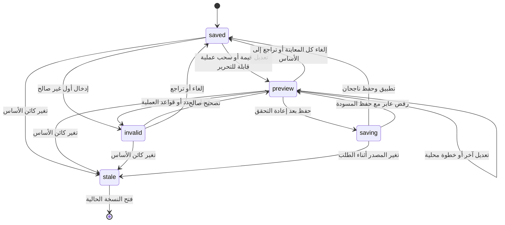

# مساحة مراجعة الإنتاج — عقد الدمج والتفاعل

4 نوفمبر 2026. تصف الوثيقة التنفيذ الحالي لمسار المصنع `production` لمراجعة القطع وتوزيع الخام وعمليات الوصفات. يبقى `machines` لتعريف الآلات، و`assembly` لقواعد الدواليب ونعلة الرخام، و`tracking` لأحداث التنفيذ السحابية. يعتمد الوصف على المصدر الحالي، ولا يثبت وحده نجاح الرحلة في المتصفح. نتائج التشغيل واللقطات والقيود تجمع في تقرير التحقق المنفصل. لا توجد هنا نتائج دراسة استخدام بشرية.

## الكائنات والمهام

العلاقة الأساسية: **مشروع ← صف/وحدة أو مصدر مركب ← قطعة تصنيع ← صنف خام ← توزيع على خام جديد/باقٍ ← عملية ← آلة أو مورد خارجي**. تأتي القطع والمشتريات والعمليات من `buildFactoryQuote` للوثيقة الحالية أو المعاينة. بعد إصدار التصنيع توجد علاقة مستقلة: **مشروع سحابي ← إيصال بإصدار ثابت ← وحدة ضمن نطاقه ← أحداث تنفيذ**.

| الكائن | هويته | المهمة |
|---|---|---|
| المشروع | `projectId` وكائن أساس `getDoc()` | الحفظ والصلاحية والتحقق من تغير المصدر |
| الوحدة/المصدر | `unitId/runId`؛ قد يكون ركنًا أو تجهيزًا مركبًا | الوصول إلى قطعها دون اختلاق وحدة CAD للمصدر المركب |
| القطعة | عنصر `quote.pieces`، مع `sku/label/a/b/count` ومصدر الوصفة | تفسير المقاس والعدد والخام والتشغيل؛ المؤشر هو هوية عرض مرتبطة بنتيجة الحصر |
| الخام وتوزيعه | `purchases[].sku` ثم `source/ref` داخل `layout/leftovers` | مراجعة القطع والبواقي والخام المشترك؛ لا يعاد تجميع القص بعد ترشيح وحدة |
| عملية الوصفة | العائلة/سطر الوصفة/مؤشر العملية | تعديل مصدر مشترك قد يؤثر في عدة وحدات؛ لا يمثل تحرير نسخة قطعة منفردة |
| الآلة | `machining.machines[].id` | اعتماد العملية والصنف والغلاف والسماحة والتثبيت، أو فتح تعريف الآلة الأصلي |
| الإيصال والحدث | `receipt/revision/unit/seq` | إثبات التنفيذ الفعلي في مسار `tracking`، مستقل عن معاينة خطة الإنتاج |

الأولوية: اختيار الوحدة ثم القطعة؛ فهم علاقتها بالخامة؛ مراجعة موضع العملية ومرجع القياس وقدرة الآلة؛ تعديل القيمة مع أثر حي؛ تصحيح أو إلغاء؛ حفظ؛ مراجعة اعتماد سجل المصنع ثم بوابات إصدار التصنيع. لا تستبدل صورة جميلة للألواح مطابقة مرجع الورشة أو تحقق الآلة.

## تقسيم الواجهة والرسم

`.production-studio` جذر معزول، يضم `.ps-header/.ps-history/.ps-summary/.ps-status` ثم `.ps-workspace` بثلاث مناطق: `.ps-objects` للكائنات، `.ps-main` للرسم والقطع، و`.ps-inspector` للتحرير والأثر. تقدم `.ps-viewbar` مشاهد `unit/cut/operation`، وتبقى `.ps-hud` شقيقة للـcanvas داخل `.ps-canvas-wrap` فلا تمحوها إعادة رسم SVG. لها صف محجوز أسفل الرسم حتى لا تحجب الأصل أو علامة الثقب. تبقى `.ps-gates` و`.ps-assembly` والمصادر وتعريفات المصنع متاحة، دون إخفاء ضوابط تشغيلية قديمة.

على العرض الواسع تكون القائمة 195px والمفتش 315px والرسم مرن العرض بارتفاع 300px. عند عرض حاوية ≤1100px تصبح القائمة أفقية فوق الرسم والمفتش المتجاورين بعرض مفتش 300px. عند ≤700px تتراص المناطق. مناطق المكتب محدودة الارتفاع مع تمرير داخلي، بما فيها الوسط حتى تظل بطاقات القطع والبحث ومراجع التجميع قابلة للوصول. مراجع التجميع قابلة للتمرير بحد 180px وتختفي حاويتها فقط إذا كانت فارغة. حقول الإدخال لا تقل عن 48px، والأزرار عن 44px. الألوان: رأس حبري، ورق دافئ للرسم، أخضر مزرق للصلاحية والتحديد، كهرماني للمعاينة، وأحمر للأخطاء، دائمًا مع نص الحالة. يحافظ CSS على `[hidden]` ويراعي تقليل الحركة.

مشهد الوحدة يعيد استخدام رسم هندسة المشروع. مشهد القص يعرض `layout/leftovers` المحسوبة للصنف في المشروع الكامل؛ لا يخصص الكلفة أو المخزون اصطناعيًا للوحدة المحددة، ولا يزعم تحسينًا أمثل للقص. لكل قطعة في الرسم ربط إلى مؤشر مصدرها فقط إذا كان التطابق وحيدًا؛ عند التباس قطع متساوية يظهر تفسير بدل اختيار مصدر اعتباطي. لا يعني مخطط القص المحسوب حجز خام أو بدء تشغيل.

مشهد العملية يستخدم مقاسات القطعة الفعلية بالملليمتر: `a × b` للوح و`a × sectionWidthMm` للمقطع. تُحوّل مراجع `xFrom/yFrom` عبر `machiningSheet`؛ لا يعاد تفسير «من نهاية القطعة» كأنه «من بدايتها». مقبض الثقب/الجيب يعرض نقطة العملية في مستوى الأبعاد نفسه. الرسم مستطيل غلاف قص عند غياب مسار هندسي أدق، ويجب أن يذكر ذلك. الثني والسماكة والوجه ومرجع التثبيت لا تصبح نموذجًا مجسمًا مثبتًا بمجرد رسم رمزها.

واجهة الرسام الخالصة هي `productionDrawing(doc,quote,{view='operation',pieceIndex=0,unitId,operationIndex=0}) → {html,caption}`. يرفض الحصر الجزئي. في مشهد العملية يحمل مستطيل `(0,0,a,b)` السمة `data-production-plane`، وتحمل العلامات `data-production-operation` ومقبض الثقب/الجيب `data-production-drag` بمؤشر العملية الأصلي. لا يقرر الرسام صلاحية التحرير؛ يفحصها المتحكم قبل بدء السحب. تستخدم جذور الرسم `data-production-drawing` حتى لا تعترض محددات أزرار تبديل المنظر. يدعم الرسم غلاف الطرف المقصوص ومسار الحشوة المتطابق مع اتجاه الخام، ويصف قطعة الركن كمستطيل إذا لم يقدم المصدر مضلع قطع مستقلًا.

## حالات المعاينة والحفظ

يفصل المتحكم `saved/preview/invalid/saving/stale` عن التحديد والمنظر والقراءة فقط. الأسماء تصف حالة الواجهة، ولا تضيف حالة تنفيذ تصنيع إلى بيانات المشروع. أولوية الحالة: حفظ جارٍ، ثم مصدر قديم، ثم إدخال غير صالح، ثم معاينة، ثم الأساس المحفوظ. عند الخطأ يعرض الرسم الأساس مع رسالة تصحيح، ويبقى النص الخام في المفتش.

| المحفز والفعل | القواعد | التغذية الراجعة | الحلقة والنهاية | الإلغاء والاستعادة |
|---|---|---|---|---|
| تحديد وحدة/قطعة/عملية | هوية تنتمي إلى نتيجة الحصر الحالية؛ تطابق المصدر بلا التباس | تحديد متسق بين القائمة والرسم والمفتش، مع مصدر الوصفة | تبديل المشهد دون كتابة المشروع | الرجوع إلى القائمة أو المصدر |
| تعديل قيمة تشغيل | مالك أو مصنع؛ مصدر حالي؛ تحليل عددي ثم قواعد المجال | معاينة العملية وقدرة الآلة والأثر على كل الوحدات المرتبطة | تصحيح متكرر ثم حفظ صريح | الإلغاء يعيد القيم المحفوظة، ولا يكتب اعتمادًا |
| سحب ثقب/جيب | أهلية مصدر العملية من المتحكم؛ إحداثيات SVG بالملليمتر وتحويل المرجع من البداية/النهاية | الموضع والحقول ورسائل القدرة تتحدث معًا | حركة متعددة داخل تفاعل واحد؛ تاريخ محلي واحد عند نهايته | Escape أو إلغاء المؤشر يعيد قيمة بداية السحب |
| حفظ التعديل | إعادة التحقق، وتنظيم السجل، وصلاحية الصفحة والمشروع، وعدم تغير المصدر | حالة حفظ ثم نجاح أو سبب رفض؛ لا مسح للعمل عند الرفض | نجاح الطلب يعيد أساس المسودة؛ يمكن إعادة محاولة الفشل العابر | لا يساوي الحفظ اعتماد المصنع أو إفراج التصنيع |
| تراجع/إعادة | المسودة أولًا؛ تاريخ المشروع عند غياب عمل معلق؛ حماية تحرير النص | الحالة والسعر/القدرة من النتيجة المستعادة | تعديل جديد يفرغ الإعادة المحلية | السجل المحلي ليس سجل التنفيذ السحابي |
| مصدر/تصدير/اعتماد | النسخة الحالية؛ إنهاء المعاينة قبل استعمال مخرج محفوظ | توضيح سبب المنع وفتح المصدر المحدد | مراجعة المصدر أو الاعتماد ثم العودة | لا تصدير لهوية أو إصدار سبق تغيره أثناء انتظار غير متزامن |

الحفظ يظل عبر `apply` الأصلي و`commitProject`، وليس كتابة مباشرة إلى التخزين. `reconcileWorkshopCatalogs` يزيد إصدار سجل المصنع عند تغيره ويلغي اعتماده؛ لا يمنح اعتمادًا ولا يغير سجل المتجر أو شروط البيع بلا تغير حقيقي. تحسم طبقة المجال أثر التعديل في `layoutRevision` والبصمات، ولا يفرض الديكور البصري نتيجة لها. للمالك والمصنع صلاحية تحرير سجل المصنع، بينما يظل التوقيع والإفراج في مسار المالك الموجود. يجب إعادة فحص الدور عند التطبيق والسجل، لا عند إظهار الضابط فقط.

`productionPieceSource` يطابق سطر وصفة مباشرًا أو ورقة خاصة صالحة تطابق مصدر القطعة وعملياتها. يرفض التحرير عند تعدد المطابقات أو توليد العمليات من سياسة تخريم اليد أو تفصيل الركن/الحشوة/التجهيز؛ تبقى روابط مصدرها متاحة. تسمح `reviewProductionPreview` باستبدال عملية أو إضافتها حتى حد المخطط، وتتحقق من العملية المحررة على **كل قطعة متأثرة** ثم تمنع ظهور أخطاء حصر/قدرة جديدة. وجود خطأ سابق في قطعة أخرى لا يتحول تلقائيًا إلى اعتماد ولا يُمحى؛ تظل بوابات المراجعة مبينة. لا تقدم المساحة أمر حذف عملية؛ يبقى محرره الأصلي في تعريفات المصنع.

تحفظ خريطة `raw` النصوص بحسب مصدر الوصفة ومؤشر العملية، وتعيد بناء المرشح عبر دوال المجال. يحفظ التراجع المحلي حتى 100 لقطة؛ السحب الواحد لقطة واحدة، ويستعيد Escape نص بداية السحب وسجل الإعادة السابق. عند انتهاء السحب غير الصالح يبقى النص قابلًا للتصحيح أو التراجع. خارج السحب يلغي Escape المعاينة كلها. عند غياب خطوة محلية وعدم وجود معاينة معلقة ينتقل التراجع/الإعادة عبر `onHistory/canHistory` إلى سجل المشروع الأصلي. المسودة في الذاكرة فقط؛ لا توجد وصفة استعادة لها بعد إعادة التحميل، ويبقى حارس العمل غير المحفوظ مسؤولًا عن المغادرة.

## قواعد التصنيع الثابتة

`cleanMachineBook` و`cleanPartOperations` يملكان مخطط الآلة والعملية وحدودهما. يراجع `machiningSheet` اعتماد الصنف ونوع العملية، غلاف الآلة، السماحة، سماكة وجه التشغيل وعمقه، حدود الحافة والماسك، شكل المادة بعد قص الطرف، زاوية القطع ونصف قطر الثني، ومسار التشذيب. قص اللوح المستطيل يجب أن يطابق أبعاد القطعة ومرجع الصفر. الوضع `strict` يلزم مسارات التشغيل والمطابقة المطلوبة للأطراف؛ لا يختفي هذا الخيار بالتصميم الجديد.

تستخدم خطة الخام `packedStock` واتجاه القطعة وعرض المنشار والبواقي المسجلة. حد تخطيط المتصفح وعدد القطع وفشل اتساع الخام تبقى أخطاء مصدرية لا تعالج بتصغير الرسم. `candidateFinishDate` تقدير يعتمد التوريد والرصيد والتوقيت والطاقة وأيام العمل؛ لا يمثل حجز آلة أو وعد تركيب. موافقة سجل المصنع واكتمال الحصر وجاهزية الإصدار مفاهيم منفصلة.

## التنفيذ السحابي مستقل

المسار القائم هو `issued → planned → passed → packed → installed → accepted`. فحص مرفوض يسجل حدثًا ويبقى في `planned` حتى إعادة قياس ناجحة. يثبت المالك السماحات ويؤكد الاستلام النهائي؛ يستطيع المصنع تسجيل الجودة والتغليف والتركيب بحسب الحالة. العدد سماحته صفر، والقراءة الفعلية إلزامية ولا تستبدل بالاسمي.

كل طلب يتضمن الإيصال والوحدة و`expected seq` ومعرف محاولة لإعادة الطلب بأمان. الخادم يتحقق من اللقطة الثابتة وصلاحية الدور مجددًا، ويراجع جاهزية آخر إصدار للموقع عند التغليف والتركيب. الأحداث إضافية ولا توجد عملية Undo لحذفها؛ لا توصل تراجع المشروع إليها. اختيار عرض وحدة من المشروع المحلي لا يثبت أنها النسخة الصادرة بإيصال. سجل التنفيذ والـDXF الصادر يبقيان مربوطين بالإيصال الأصلي.

## مصادر القواعد وحدود التحقق

| المصدر | العقد القائم |
|---|---|
| [`public/kitchen-production-studio.js`](../../public/kitchen-production-studio.js) | حالة المسودة، الإدخال، السجل والحفظ، البوابات، السحب واستعادته وربط السجل الأصلي |
| [`public/kitchen-production-preview.js`](../../public/kitchen-production-preview.js) | حل مصدر القطعة، منع تحرير المولدات والالتباس، مراجعة العملية على كل القطع المتأثرة وتنظيم سجل المصنع |
| [`public/kitchen-production-drawing.js`](../../public/kitchen-production-drawing.js) | إسقاط SVG بلا تعديل؛ مستوى الملليمتر؛ مخطط القص الكامل وربط المؤشرات عند التطابق الوحيد |
| [`public/kitchen-gateways.js`](../../public/kitchen-gateways.js)، [`public/kitchen-workshop-ui.js`](../../public/kitchen-workshop-ui.js)، [`public/kitchen-role-pages.js`](../../public/kitchen-role-pages.js) | ملكية المسارات، تركيب مساحة الورشة، صلاحية الصفحة والحفظ والسجل |
| [`public/kitchen-machining.js`](../../public/kitchen-machining.js) | `cleanMachineBook` 9، `cleanPartOperations` 23، `machiningSheet` 37، `candidateFinishDate` 82 |
| [`public/kitchen-workshop-factory.js`](../../public/kitchen-workshop-factory.js) | `purchaseRequirements` 194؛ `buildFactoryQuote` ونتائج القطع والمشتريات والعمليات والجاهزية |
| [`public/kitchen-workshop-factory-stock.js`](../../public/kitchen-workshop-factory-stock.js) | `packedStock` 19؛ مواضع القطع والبواقي 38–43 |
| [`public/kitchen-workshop-factory-ui.js`](../../public/kitchen-workshop-factory-ui.js) | تحديث السجل واعتماده 104–127؛ حل مصدر القطعة عند التطابق الوحيد 423–442 |
| [`public/kitchen-machining-ui.js`](../../public/kitchen-machining-ui.js) | محرر تعريفات الآلة والوصفة 8–39؛ لوحة التشغيل والموعد الحالية 41–47 |
| [`public/kitchen-sheet.js`](../../public/kitchen-sheet.js)، [`public/kitchen-proposal-presentation.js`](../../public/kitchen-proposal-presentation.js) | رسم الوحدة والواجهة والمسقط من هندسة المشروع |
| [`public/kitchen-drawing-viewport.js`](../../public/kitchen-drawing-viewport.js)، [`public/kitchen-drawing-output.js`](../../public/kitchen-drawing-output.js) | كاميرا SVG وختم المخرجات، دون إعادة حساب هندسة التصنيع |
| [`public/kitchen-catalog-records.js`](../../public/kitchen-catalog-records.js)، [`public/kitchen-project.js`](../../public/kitchen-project.js)، [`public/kitchen-workshop-state.js`](../../public/kitchen-workshop-state.js) | تنظيم السجلات والحفظ والتاريخ وبصمات الاعتماد وبوابات الإفراج |
| [`public/kitchen-order-tracking-ui.js`](../../public/kitchen-order-tracking-ui.js)، [`app/api/jobs/route.ts`](../../app/api/jobs/route.ts) | مراحل التنفيذ 20–33؛ حراس الطلب وتسلسل الحدث والسماحات والجودة 97–147 في الخادم |
| [`public/kitchen-production-studio.css`](../../public/kitchen-production-studio.css) | العقد البصري المعزول وأحجام التحكم والاستجابة للشاشات |
| [`tools/check-kitchen-machine-capacity.mjs`](../../tools/check-kitchen-machine-capacity.mjs)، [`tools/check-kitchen-workshop-factory.mjs`](../../tools/check-kitchen-workshop-factory.mjs)، [`scripts/check-workshop-jobs.mjs`](../../scripts/check-workshop-jobs.mjs) | اختبارات القدرة والحصر والخام، والطلبات السحابية وتعارض النسخ والأدوار والتكرار |
| [`tools/check-kitchen-production-drawing.mjs`](../../tools/check-kitchen-production-drawing.mjs) | إحداثيات مستوى التشغيل ومرجع النهاية؛ الثقب والجيب؛ الخام المشترك والبواقي؛ مصدر وحيد مقابل الالتباس؛ هروب النص؛ مسار الحشوة؛ رسم الجدار الفعلي وعدم تغيير المدخلات |
| [`tools/check-kitchen-production-preview.mjs`](../../tools/check-kitchen-production-preview.mjs)، [`tools/check-kitchen-production-workshop.mjs`](../../tools/check-kitchen-production-workshop.mjs) | عقد معاينة المصدر المشترك ورحلة المتحكم؛ نتائج تشغيلهما توثق في تقرير التحقق |

قراءة الاختبارات لا تثبت تشغيلها، والمحاكاة الآلية لا تثبت فهم العامل لمرجع القياس أو صلاحية ورقة تشغيل على آلة حقيقية. يحدد التقرير ما جرى اختباره فعلًا؛ لا يقدم الرسم بوصفه برنامج CNC أو تحققًا ميدانيًا أو إثبات تنفيذ.
