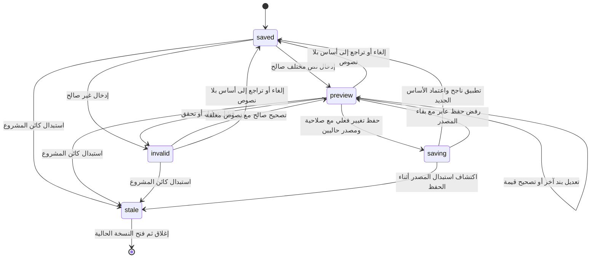

# مساحة الحصر والتسعير — تكامل التنفيذ

تاريخ المراجعة: 4 نوفمبر 2026. تصف الوثيقة المسار الفعلي `quote` الذي يركّب `mountQuoteStudio` داخل الورشة، مع الحاسب والسجل الكامل والحفظ والاعتماد الأصليين. هي مواصفة مستندة إلى المصدر والاختبارات المكتوبة؛ نتائج التشغيل واللقطات وحدود التحقق يجمعها [تقرير مراجعة مساحة الحصر](quote-studio-review/REPORT.md) منفصلًا. لا تتضمن ادعاء دراسة استخدام بشرية أو قياس سرعة أو انخفاض أخطاء.

## الكائنات والمهام

النموذج الذهني المقصود: **المشروع ← الوحدة/مصدر الاستهلاك ← قطعة التصنيع ← صنف الخام ← أثر السعر على عرض العميل**. مصدر الكميات هو `buildFactoryQuote`؛ لا تنشئ الواجهة حصرًا موازيًا أو سعر وحدة بيع مفترضًا.

| الكائن | الهوية والعلاقات الفعلية | المهمة في الواجهة |
|---|---|---|
| المشروع | `room.projectId`، `kitchen`، `room.workshop`، وكائن الأساس الذي أعاده `getDoc()` | نقطة الحفظ والصلاحية والمقارنة مع النسخة الحالية |
| الوحدة | `unit.id` و`runId`؛ الرمز `U1…` وصف عرض مشتق من ترتيب الوحدات | تضييق قائمة الخامات والقطع؛ فتح الوحدة في المصمم أو التشطيب |
| قطعة التصنيع | `quote.pieces` بهويات `unitId/runId/sku` واسم القطعة ومقاساتها وعددها | تفسير استخدام الخام وعرض القطع المرتبطة بالصنف المحدد |
| صنف الخام | `sku` في كتالوج المشروع، تقابله مشتريات مجمعة في `quote.purchases` | البحث، مراجعة سعر وحدة شراء الخام، رؤية المصادر المستهلكة له، وفتح سجله الأصلي |
| شرط البيع | أحد `labor/installation/delivery/marginPct/taxPct/worktop` | تعديل قيمة المشروع كله أو نطاق خامة السطح، دون نسبتها إلى الوحدة المحددة |
| معاينة التعديل | خريطة نصوص `raw` بمفاتيح `sku:…` و`term:…`؛ منها تنتج `preview.doc/quote` | الاحتفاظ بتعديلات عدة أصناف وشروط، وإظهار الأثر دون كتابة المشروع |
| العرض والاعتماد | نتيجة الحاسب، مفاتيح الهيكل/العميل/الإفراج، وسجل `versions` | معاينة العميل، تفسير المتطلبات، ثم الانتقال إلى الاعتماد الأصلي |

قد تحمل قطع الزوايا أو التجهيزات هوية مصدر مركبة لا تقابل وحدة CAD عادية. تظل هذه القطع ضمن حصر المشروع؛ لا تتحول إلى وحدة وهمية قابلة للفتح. يدعم تقرير العميل تصميمًا يحتوي زوايا فعلية ولو كانت قائمة الوحدات خالية. تربط دالة `quoteProvenance` القطع بالمصادر والخامات للاستخدام البرمجي؛ المتحكم الحالي يبني المرشحات مباشرة من `pieces/purchases`.

ترتيب المهام: فهم الإجمالي وحالته؛ تحديد وحدة أو خام وتتبّع القطع؛ تعديل سعر أو شرط مع مشاهدة الأثر؛ تصحيح الإدخال أو التراجع؛ حفظ جميع التعديلات معًا؛ معاينة عرض العميل؛ معالجة البوابات وتسجيل الموافقة. اليمين للفهرس والبحث، الوسط للوحدات والخامات والقطع، اليسار للسعر والأثر وروابط المصدر. يبقى سجل المشتريات والقص والتصدير داخل إفصاح مستقل، مع توضيح أنه يخص النسخة المحفوظة.

## معنى الأرقام وحدود التحرير

اختيار وحدة **يرشح المصادر المعروضة فقط**. قيمة صف الخام وكمية شرائه تظلان للمشروع كاملًا؛ قد يشترك عدد من الوحدات والزوايا في اللوح أو المقطع نفسه وفي تجميع القص والبواقي. لا تقسّم الواجهة كلفة الشراء على عدد الوحدات، ولا تجمع عروضًا جزئية لتنتج عرض المشروع. السعر المحرر هو سعر وحدة شراء الصنف في كتالوج هذا المشروع، ويؤثر في كل استعمالاته.

يفصل الملخص بين `materialValue`، أي قيمة مواد التصنيع بحسب الحاسب، وبين `additionalPurchaseCost`، أي الإنفاق الإضافي المطلوب بعد الرصيد. قد يستخدم الحاسب البواقي أو خامًا متاحًا؛ لا يتساوى المؤشران بالضرورة. حساب البيع يبقى: تكلفة الخام والإضافات والسطح المشمول والخدمات، ثم إضافة البيع `marginPct` على التكلفة، ثم `taxPct` على البيع، بالتقريب الموجود في الحاسب. تسمية إضافة البيع لا تعني هامش ربح محسوبًا كنسبة من سعر البيع.

- يقبل المحرر النص الرقمي عبر `assistNumber`، بما فيه الأرقام العربية المدعومة. الفراغ يتحول إلى `null` غير محسوم؛ الصفر سعر صريح. النص غير الصالح لا يحوّل إلى صفر ولا يحفظ.
- حدود أسعار الشراء والخدمات: من صفر إلى `100000000` أو `null`. النسب: من صفر إلى 100 أو `null`. نطاق السطح: `separate/include` فقط. ترفض الدالة مفاتيح الأصناف أو الشروط المجهولة والقيم غير المحدودة أو ذات النوع غير الصحيح.
- سهمَا ↑/↓ يعدّلان الرقم بمقدار 1، ومع Shift بمقدار 10، عبر مسار المعاينة نفسه. لا توجد إيماءة سحب لعنوان السعر في هذا التنفيذ. مقاسات القطع في سجل الحصر بالملليمتر؛ عرض الوحدة في CAD يحول من السنتيمتر للعرض بالضرب في 10.
- إذا كان الإجمالي قبل التعديل أو بعده غير محسوم، يبقى فرق الإجمالي `null` وتشرح الواجهة أن الفرق ينتظر اكتمال التسعير؛ لا تختلق فرقًا عدديًا.
- النص الخام مستقل عن المساواة العددية: إدخال تمثيل مختلف للقيمة نفسها قد يظل معاينة معلقة رغم `changed=false`؛ زر الحفظ يتطلب تغييرًا فعليًا، ويمكن إنهاء النص المعلق بالإلغاء.

## آلة الحالات الفعلية

تكتب `update()` الحالة في `data-state` بالأولوية التالية: `saving` ثم `stale` ثم `invalid` ثم `preview` ثم `saved`. هذه حالة واجهة مشتقة؛ لا يضاف تعداد حالات إلى مخطط المشروع. التحديد والبحث وحالة القراءة فقط أبعاد مستقلة.

| الحالة | الشرط الفعلي | الدلالة والضوابط |
|---|---|---|
| `saved` | لا `busy` ولا اختلاف مصدر ولا خطأ ولا مفاتيح في `raw` | أساس العرض هو نسخة المشروع الحالية؛ يمكن الاستعراض وفتح المصادر والسجل. الاسم وحده ليس دليل اعتماد أو ضمان حفظ سحابي |
| `preview` | نصوص `raw` موجودة، والتقييم لم ينتج خطأ | يعرض الحاسب المرشح وأثره؛ تتراكم تعديلات عدة بنود، ويمنع الانتقال إلى المصادر والاعتماد والسجل المحفوظ |
| `invalid` | فشل تحليل/تحقق الإدخال في `review` | يبقى النص الخام؛ يعود الحصر المعروض إلى الأساس، ويذكر الملخص أنه إجمالي النسخة المحفوظة؛ يمنع الحفظ وتقرير المعاينة والاعتماد |
| `saving` | `busy=true` أثناء `apply` | تعطيل التحرير والتحديد وإجراءات التغيير؛ يعاد التحقق من المصدر والصلاحية قبل الكتابة ومن هوية المشروع الناتج بعدها |
| `stale` | `getDoc() !== doc` أو فقد المتحكم مصدره | منع الكتابة والسجل والمصادر والمخرجات القديمة؛ المطلوب فتح الحصر الحالي، دون تطبيق المعاينة تلقائيًا على مشروع آخر |

**القراءة فقط مستقلة عن الحالات السابقة.** يقبل `canEditWorkshopPage(role,'quote')` المالك وحده لأن المساحة تجمع أسعار المتجر وشروط التسعير. يمكن للأدوار المسموح لها فتح الحصر استعراضه؛ تبقى محررات سجلات الأدوار المحدودة في صفحاتها الأصلية. `editable()` يشترط مصدرًا حاليًا، وعدم الحفظ، و`canEdit()`. عند سحب الصلاحية أثناء وجود عمل، تجمّد طبقة الورشة الإدخال والسجل وتحفظ النص الظاهر حتى قرار التخلص الصريح. لا يمنح إظهار زر مصدر صلاحية تحرير الوجهة، ولا ينفذ زر الاعتماد توقيعًا من داخل الحصر.

| النمط | المحفز والفعل | القواعد | التغذية الراجعة | الحلقة والنهاية | الإلغاء/الاستعادة |
|---|---|---|---|---|---|
| تحديد وفهم المصدر | اختيار وحدة أو صنف أو شرط؛ البحث بالاسم/الرمز | هوية حالية، لا حفظ جارٍ؛ استبعاد هوية غير موجودة | تمييز متسق، قطع مرتبطة، سعر وأثر وروابط المصدر | تبديل الكائن مع بقاء نصوص كل البنود؛ لا كتابة بالاختيار | مسح البحث أو اختيار المشروع كاملًا |
| تحرير ومعاينة | كتابة أو أسهم داخل الحقل، أو تغيير نطاق السطح | المالك؛ تحليل كل نصوص المسودة والتحقق منها عبر `reviewQuotePreview` | الملخص والقوائم والأثر تتحدث؛ خطأ نصي و`aria-invalid` عند الرفض | تصحيح متكرر أو تحرير بند آخر؛ لا حفظ ضمني | زر الإلغاء أو Escape يلغي **كل** تعديلات العرض المعلقة |
| تراجع محلي | أزرار الرأس أو Ctrl/Cmd+Z وShift+Z خارج حقول النص | لا حفظ أو مصدر قديم؛ صلاحية تحرير | استعادة خريطة النصوص وإعادة الحساب | تعديل جديد يمسح الإعادة؛ عند غياب سجل محلي وعمل معلق يمكن استخدام سجل المشروع | يحتفظ الحقل بسلوك تحرير النص الأصلي؛ لا يعترض المتحكم اختصاره داخله |
| حفظ | زر حفظ التعديلات | تغيير فعلي صالح؛ مراجعة جديدة ثم `apply` الأصلي؛ لا تطبيق عند تغير المصدر/الدور | حالة حفظ ثم نجاح أو سبب رفض واضح | نجاح: أساس جديد ومسح المسودة والسجل المحلي؛ رفض عابر: تبقى المعاينة قابلة لإعادة المحاولة دون إعادة الكتابة | الإلغاء متاح بعد انتهاء محاولة الحفظ؛ لا تمسح المسودة عند الرفض |
| مصدر/سجل/تصدير | فتح الصنف أو شروطه أو الوحدة أو التشطيب، أو إجراء داخل السجل | `current()` وغياب `pending()`؛ التصدير يعيد التحقق داخل دالته | رسالة تطلب حفظ المعاينة أو إلغاءها؛ فتح المصدر المحدد عند السماح | مراجعة المصدر في صفحته ثم إعادة فتح الحصر | حارس مغادرة الورشة يحمي العمل غير المحفوظ |
| عرض العميل | زر المعاينة العلوي | لا خطأ أو حفظ؛ مشروع حالي وتصميم وحدات أو زوايا؛ تحقق بعد تحميل الوحدات البرمجية | تقرير محفوظ أو «مقترح لمراجعة العميل» حسب وجود المسودة | لا كتابة ولا اعتماد؛ إغلاق التقرير يعود للعمل | تغير `epoch` أو المصدر أو إزالة العنصر أثناء الانتظار يلغي النتيجة القديمة |
| اعتماد النسخة | زر مراجعة واعتماد النسخة | لا مسودة/خطأ؛ بوابات الهيكل والحصر والتجهيز والميزانية ومراجعة التصميم | انتقال إلى `sign` لقراءة الشروط وتسجيل الاسم والسبب عند الحاجة | إنشاء إصدار عبر المسار الأصلي فقط | معالجة البند المعطل والعودة؛ لا تجاوز من حالة المعاينة |

## الحفظ والسجلات وحدود الاستعادة

`reviewQuotePreview` دالة بلا حفظ أو توقيع: تتحقق من المدخلات والكتالوج، وتنسخ الكتالوج عند وجود تغير فقط، ثم تستدعي `reconcileWorkshopCatalogs`. يذهب سعر الصنف إلى `storeCatalog`، وشرط البيع إلى `pricingTerms`. يزيد إصدار السجل المتغير مرة واحدة وتلغى موافقته وحده؛ تبقى وصفات المصنع واعتمادها كما هي عند التعديل التجاري البحت. تزيد `catalogMeta.revision` وتبقى `layoutRevision` ما دامت هندسة الكتالوج لم تتغير. لا يكتب النموذج المسطح `catalog` إلى جانب السجلات كمرجع مستقل، ولا تمنح المعاينة اعتمادًا.

الحفظ يجمع التعديلات في طلب واحد إلى `apply:commit` داخل الورشة، ثم المحرر و`commitProject`. تعيد هذه الطبقات فحص الصلاحية، وتغير النسخة، وتنظيم السجلات، وصحة المشروع والحفظ. رفض التخزين في مشروع الورشة لا يستبدل النسخة المحفوظة. بعد نجاح التطبيق يعيد المتحكم قراءة `getDoc()` كأساسه الجديد لأن طبقة الحفظ قد تنظّم الكائن. إذا أعاد المضيف نجاحًا مع `saved:false`، تظهر رسالة أن التغيير في الجلسة فقط مع طلب تصدير نسخة؛ هذه حالة تعاقدية يتعامل معها المتحكم، وليست ادعاء نجاح الحفظ الدائم. رفض المحاولة يسجل رسالة `notice` بدل تحويل الإدخال الصحيح إلى `invalid`، ولذلك يبقى زر الحفظ قابلًا لإعادة المحاولة ما دامت الصلاحية والمصدر صالحين.

سجل المعاينة محلي في الذاكرة: لقطة لخريطة `raw` عند كل تغير إدخال، بحد 100 في اتجاه التراجع؛ التعديل الجديد يمسح الإعادة. نجاح الحفظ أو الإلغاء يمسح السجل المحلي. عندما لا توجد معاينة معلقة ولا خطوة محلية في الاتجاه المطلوب، يستدعي المتحكم `onHistory/canHistory` للوصول إلى تاريخ المشروع الأصلي، مع استعادة سياق الوحدة والصنف/الشرط. ذلك التاريخ في `sessionStorage` بحد أقصى 25 لقطة لكل اتجاه وفق المساحة، ويعيد الحفظ وفحص الصلاحية عند السفر؛ ليس سجل تدقيق سحابيًا.

لا تملك مسودة الأسعار وصفة استعادة في `localStorage`. إعادة التحميل لا تعد باسترجاع النصوص المعلقة؛ يسجل `hasPending` مع حارس العمل غير المحفوظ، وتستطيع الورشة طلب البقاء أو التخلص الصريح قبل المغادرة. حفظ المشروع ومزامنته وإصداره تستمر في مساراتها الأصلية؛ هذه الواجهة لا تضيف تخزينًا أو مصادقة جديدة.

## المصدر والمخرجات والاعتماد

السجل الأصلي مركب عبر `mountQuoteStep` مع `getDoc` الحقيقي وحارس `isCurrent: current() && !pending()`. حارس التقاط النقر يمنع أزرار السجل وروابطه عند وجود معاينة أو مصدر قديم. تعيد `exportLedger` فحص الحارس وهوية المصدر داخل مسار التنزيل نفسه، وتصدر القيم الخام مع هوية المشروع ونسخة الكتالوج وختم المخرج؛ لا تصدر نصوص أزرار العرض. تبقى مصادر القطعة والوحدة والصف والصنف والوصفة في السجل قابلة للفتح بحسب هويتها الأصلية.

معاينة العميل العلوية تسمح بمراجعة المقترح الصحيح قبل الحفظ: تستخدم `preview.doc` و`saved:false`؛ عند غياب المسودة تستخدم المشروع و`saved:true`. يفحص التقرير العلوي المصدر و`epoch` بعد انتظار الاستيراد، بينما يفحص تقرير السجل المصدر و`isCurrent` بعد انتظاره. بذلك لا ينتج تقرير قديم إذا بدأ إدخال محلي أو تغير المشروع أثناء التحميل. التصنيف «محفوظ/مقترح» لا يساوي موافقة عميل أو إفراج ورشة، والتحذير الخاص بتطبيق الجلسة فقط يظل ضروريًا إذا أعاد المضيف `saved:false`.

تعرض نافذة التقرير HTML المولد داخل `iframe.srcdoc` بدل التنقل إلى عنوان Blob. يحتفظ الإطار بـ`sandbox="allow-same-origin allow-modals"` دون تشغيل سكربتات، ويضاف `<base href="about:srcdoc">` إلى النسخة المعروضة ليبقى التنقل بين أقسام التقرير داخلها. يظل Blob مصدر تنزيل ملف HTML ويُلغى عنوانه عند إغلاق المعاينة؛ لا يغيّر الإصلاح بيانات التقرير أو إجراء الحفظ والاعتماد. إثبات العرض الفعلي في المتصفح المضمّن ونتيجة الطباعة والتنزيل بحسب ما اختُبر تسجل في التقرير المنفصل، ولا تستنتج هنا من اختبار محاكاة الإطار.

بوابات مساحة الحصر هي: مراجعة تعارض التصميم مع الرفع، اعتماد الهيكل الحالي، اكتمال التسعير، حسم تجهيز قواعد الدواليب والنعلة، وحد الميزانية. تشير الصفحة أيضًا إلى سجلات المتجر/المصنع/التسعير التي تحتاج اعتمادًا قبل إصدار الورشة. اكتمال السعر `complete` مستقل عن جاهزية الإنتاج `ready`؛ لا تعدّ موافقات السجلات وحدها شرطًا مستحدثًا لموافقة العميل، وتبقى ضمن بوابات الإفراج القائمة.

تغيّر السعر أو الشرط التجاري يحافظ على الهندسة ومفتاح اعتماد الهيكل عندما لا تتغير مدخلاته، لكنه يغير مدخلات بصمة العميل والإفراج. لا تمحو الدالة سجلات الاعتماد أو الإصدارات القديمة؛ تصبح موافقة العميل قديمة عند اختلاف المفتاح. تحفظ المعاينة الوثيقة الأصلية كما هي، ويظهر الأثر على الوثيقة المعتمدة بعد الحفظ الفعلي.

تتولى صفحة `sign` التحقق مجددًا وتسجيل اسم المعتمد. ينشئ `recordCustomerVersion` موافقة العميل وإصدارًا مرقمًا يحفظ الاسم والتاريخ والمفتاح والسعر وملخص الوحدات. يتطلب أي إصدار تالٍ سبب تعديل، ويرفض تكرار مفتاح آخر إصدار. يبقى إفراج التصنيع إجراءً مستقلًا باسم مسؤول الورشة، خاضعًا لـ`releaseConcerns` بما يشمل موافقة العميل وسجلات الكتالوج وملاحظات الحصر والإنتاج والتجهيز والموقع وبقية القيود الأصلية. زر المعاينة أو الحفظ لا يطلق التصنيع.

## مصادر التنفيذ والاختبارات

أرقام الأسطر تخص المراجعة الحالية وقد تتحرك لاحقًا. الاختبارات أدناه **تصف تغطية مكتوبة**؛ هذه الوثيقة لم تشغّل الحزمة ولم تستنتج نجاحها من وجود الاختبار. يوثق التقرير المنفصل ما شغّل فعلًا، بما فيه الفرق بين محاكاة DOM والمراجعة في المتصفح.

| المصدر | نقاط الرجوع |
|---|---|
| [`public/kitchen-quote-studio.js`](../../public/kitchen-quote-studio.js) | الحالة والهوية 22–34؛ الإدخال والسجل 35–64؛ الحفظ وإعادة المحاولة 65–82؛ المصدر والتقرير 83–97؛ الكائنات 98–141؛ البوابات والحالات 142–168؛ ربط السجل والأحداث 169–210 |
| [`public/kitchen-quote-preview.js`](../../public/kitchen-quote-preview.js) | المخطط والحدود 18–36؛ النسخ وتنظيم السجلات وحساب الفروق 37–54؛ علاقات المصدر 57–71 |
| [`public/kitchen-workshop-factory.js`](../../public/kitchen-workshop-factory.js) | حاسب المشروع `buildFactoryQuote`؛ المشتريات والخدمات والقيمة والإجمالي والجاهزية 371–388 |
| [`public/kitchen-catalog-records.js`](../../public/kitchen-catalog-records.js) | حفظ سلطة السجلات وإصداراتها واعتمادها في `reconcileWorkshopCatalogs`، 94–118 |
| [`public/kitchen-role-pages.js`](../../public/kitchen-role-pages.js) | أهلية الفتح 13–23؛ تحرير الحصر للمالك وحده 25–33 |
| [`public/kitchen-workshop-ui.js`](../../public/kitchen-workshop-ui.js) | حارس المغادرة والكتابة 201–218؛ تاريخ المشروع 227–239؛ تركيب المساحة 331–334؛ بوابات العميل والإفراج 437–447؛ التوقيع والإصدار 455–483 |
| [`public/kitchen-project.js`](../../public/kitchen-project.js) | تاريخ الجلسة 93–97؛ فحص المصدر والحفظ 198–220؛ تراجع 222 وإعادة 256 |
| [`public/kitchen-workshop-factory-ui.js`](../../public/kitchen-workshop-factory-ui.js) | السجل ومصادره 396–412؛ التصدير ومصدر التقرير وحراسه 488–521 |
| [`public/kitchen-workshop-state.js`](../../public/kitchen-workshop-state.js)، [`public/kitchen-design-versions.js`](../../public/kitchen-design-versions.js) | مفاتيح الموافقات 156–178 وبوابات الإفراج 182 وما بعدها؛ إنشاء الإصدار وتسجيله 88–101 |
| [`public/kitchen-proposal-presentation.js`](../../public/kitchen-proposal-presentation.js) | `customerReport` وتصنيف المحفوظ/المقترح 227–234 |
| [`public/kitchen-report-preview.js`](../../public/kitchen-report-preview.js)، [`tools/check-kitchen-report-preview.mjs`](../../tools/check-kitchen-report-preview.mjs) | نافذة `srcdoc` ومرجع الروابط الداخلية وحجر السكربتات؛ Blob التنزيل وإلغاؤه؛ اختبار العقد المكتوب |
| [`public/kitchen-quote-studio.css`](../../public/kitchen-quote-studio.css) | العزل في `.quote-studio`، الملخص والحقول والحالات؛ ثلاث مناطق على الواسع، وفهرس أفقي أعلى الحصر والمفتش المتجاورين عند عرض حاوية ≤1100px، ثم ترتيب رأسي عند ≤700px؛ التمرير الداخلي و`[hidden]` وتقليل الحركة |
| [`tools/check-kitchen-quote-preview.mjs`](../../tools/check-kitchen-quote-preview.mjs) | مصدر الكميات وعدم التعديل 38–50؛ الحساب والفراغ/الصفر والحدود 52–95؛ السجلات والبصمات 98–130؛ علاقة المصادر والحفظ وإعادة الفتح والسجل ورفض التخزين/النسخة القديمة 133–161 |
| [`tools/check-kitchen-quote-workshop.mjs`](../../tools/check-kitchen-quote-workshop.mjs) | رحلة الورشة بمحاكاة أحداث DOM: المعاينة والسجل والحفظ 144–161؛ الاعتماد والإصدارات 163–197؛ القيمة المجهولة والبوابات 199–235؛ إعادة محاولة الحفظ والصلاحية 237–263؛ تقارير العميل وحراس السباق والزوايا 265–312 |
| [`tools/check-kitchen-output-interactions.mjs`](../../tools/check-kitchen-output-interactions.mjs)، [`tools/check-kitchen-role-pages.mjs`](../../tools/check-kitchen-role-pages.mjs)، [`tools/check-kitchen-catalog-records.mjs`](../../tools/check-kitchen-catalog-records.mjs) | مصادر السجل الأصلية وتبديل مشاهده، حدود الأدوار، واستقلال سجلات المتجر والمصنع والتسعير |

لا تثبت اختبارات المجال ومحاكاة الأحداث وحدها سلوك التخطيط المرئي أو استخدام جهاز لمس حقيقي أو فهم المالك لمعنى الخام المشترك. هذه حدود تحقق يجب أن تبقى ظاهرة في التقرير، ولا تتحول إلى ادعاء قبول بشري أو نتائج تجريبية مقاسة.
