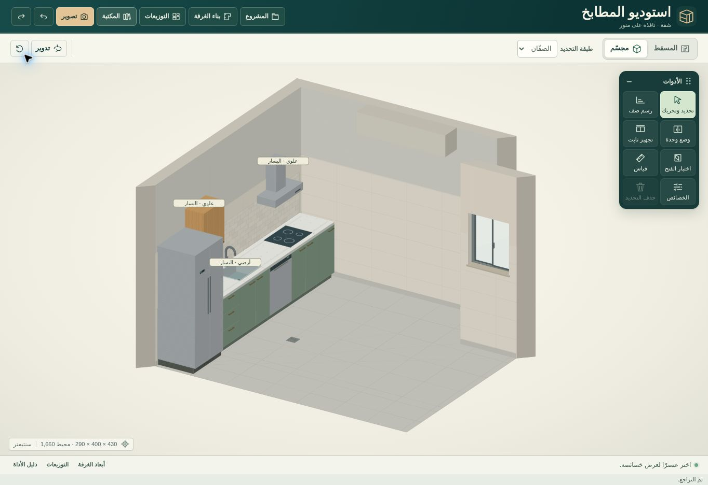
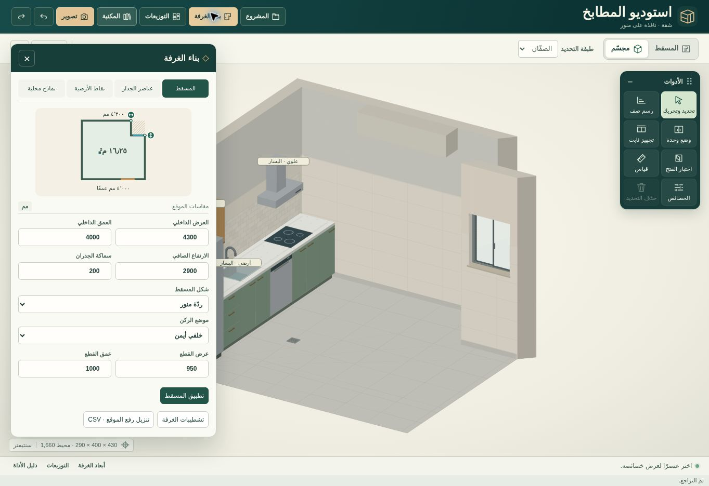

# رفع غرفة المطبخ
أبعاد المسقط هي المقاسات الداخلية بعد التشطيب. تُدخل قياسات الرفع بالملّيمتر وتُحفظ في نموذج الاستوديو المشترك (سنتيمتر). يرجع موضع العنصر إلى بداية ضلع الجدار المتبقي؛ في الرسم توضّح الدائرة نقطة البداية والسهم اتجاه ازدياد المسافة. إحداثيات بلاعات الأرضية من يسار وخلف المستطيل المحيط بالمسقط. المساحة المعروضة صافية من ردة المنور أو الشطف، وليست مساحة متبقية بعد طرح الأثاث.

يسند النموذج المستطيل، وردّة واحدة قائمة أو مشطوفة، أو فرق عرض بين طرفي الغرفة. يمكن إضافة أعمدة وكمرات وبروزات وسخان وخدمات متعددة محلية على الجدران. اختيار حوش أو ممر أو غرفة غسيل يصف الجهة المقابلة للفتحة؛ هذا محرر غرفة واحدة وليس محاكاة غرف متجاورة كاملة. تتغير كاميرا التصوير حسب احتياجات التصميم. الصور الناتجة محاكاة للمقاسات والنموذج المحددين.

## أصل الأمثلة
- [روشن، سدرة — الفيلا VL1](https://alb-home.roshn.sa/docs/pdf/448/SEDRA_Brochure_2092025_155aa70cdb/SEDRA_Brochure_2092025_155aa70cdb.pdf): البعد المنشور للمطبخ 4.4 × 3.8 م.
- [NAF 7، كتيب المشروع](https://naf.com.sa/uploads/5705152_pdf_638806399611390703.pdf): استُخدمت مساحة مطبخ منشورة 16.25 م². المستطيل 4.30 × 4.00 م مع ردة 0.95 × 1.00 م تمثيل مقترح يحقق هذه المساحة، وليس نسخًا لمخطط الشقة.
- [الأصالة بالأحساء، نموذج شرفة D](https://ruh-s3.bluvalt.com/api-nhc.sa/s3fs-public/2023-03/%D8%A7%D9%84%D8%A3%D8%B5%D8%A7%D9%84%D8%A9_compressed_compressed.pdf): في جدول النموذج مطبخ 4.6 × 3.4 م وغسيل 1.6 × 3.4 م. تصف فتحة الخدمة في المثال الاتصال بالغسيل ولا تنشئ مساحة الغسيل كغرفة ثانية.

سماكة الجدران والارتفاعات والمناسيب والأبواب والنوافذ واتجاه الفتح والمواد والخدمات ومساقط الخزائن أمثلة قابلة للتعديل، وليست مقاسات إلزامية أو مواصفات للمشروعات المرجعية. اعتبار تصميم صالح للتصنيع يتطلب قياسات الموقع الفعلية واعتماد طريقة التركيب.

## تجربة الرفع
من «بناء الغرفة» يمكن تحرير القياس رقمياً أو سحب مقبض الركن في مسودة المسقط، ثم تطبيقه مرة واحدة. الثوابت تتبع أضلاع المبنى؛ إعادة التوزيع تغيّر وحدات المطبخ وتحتفظ بفتحات الموقع وخدماته. لفرق بسيط بين جدارين متقابلين استخدم «جدار غير متوازٍ». تُطبع واجهة كل ضلع فعلي بما في ذلك ردّات المنور، ويخرج رفع الموقع كملف CSV مستقل عن حصر الوحدات.

يُفحص حيز فتح باب الغرفة المعرّف بأنه يفتح للداخل وفق موقع المفصلة وعرض الضلفة وارتفاع الباب. لا يطبَّق هذا القيد على باب سحّاب أو باب للخارج أو باب مجهول الحركة من ملف قديم. التداخل مع الجدار أو العنصر الثابت أو حيز الباب يحجب التعديل قبل الحفظ في سجل المشروع.

تبليط عموم الجدار مستقل عن الوزرة وكسوة الحائط فوق سطح العمل. يمكن إدخال ارتفاع الطبقة من البلاط أو مدها للسقف، وتحديد عرض البلاطة وارتفاعها.

