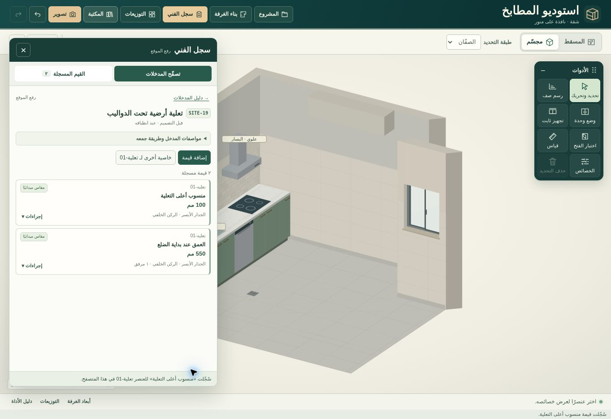
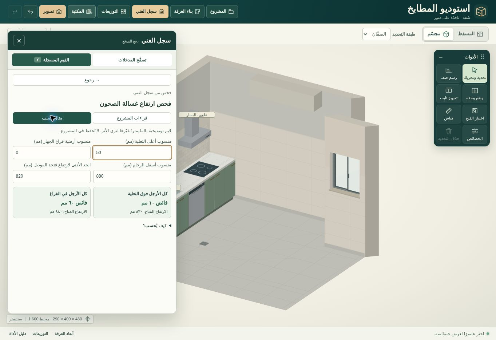

# سجل الفني
يعرض الاستوديو 137 بندًا في 10 مجموعات من «قاموس المدخلات» في الإصدار الثاني من Kitchen-Inputs.xlsx. يعرض الاحتياج وموعد الإكمال والمواصفات وطريقة الجمع ومن يؤكد المعلومة، وكيف يمثلها البرنامج والقرار المتأثر وما يُعلَّق عند النقص أو التعارض كما يصفها الدليل. شرح الدليل لا ينفذ حسابًا أو يعدل رسمًا تلقائيًا.

لكل عنصر معرّف، ولكل خاصية قراءة مستقلة. تتيح الواجهة إدخال رقم ووحدة، نص، تاريخ، نعم/لا، خيار، نقطة، مسار، مضلع، أو مستند. يمكن ربط القراءة بمرجع من الرسم أو بموقع يكتبه الفني، وإدخال مرجع القراءة والمصدر والمرفقات وتاريخها وحالة التحقق والتنفيذ. الرقم صفر قيمة، والمجهول/غير المنطبق يحفظان بدون اختراع قيمة. يمكن إضافة خاصية للعنصر نفسه أو قراءة ثانية للمراجعة. الصور والملفات محلية؛ ملف المشروع القابل للفتح في جهاز آخر يشمل بايتات المرفقات، وCSV جدول للحصر.

الفحص المحسوب المتاح في السجل هو الحد الأدنى لارتفاع فتحة موديل غسالة الصحون في موضعين استنادًا إلى أربع قراءات فعلية من مرجع رأسي واحد، أو إلى مثال مستقل اختياري مطابق للورقة الرابعة. يلزم أن تكون كل الأرجل على نفس منطقة الارتكاز. تقارن القيمة المتاحة (أسفل السطح ناقص منسوب الارتكاز) بمطلوب الموديل. لا يستنتج هذا الفحص العرض أو العمق أو التهوية أو الملاءمة الإنشائية، ولا يضيف تعلية ثلاثية الأبعاد للغرفة. مثال الملف ليس تصميم العميل ولا تُحمّل أمثلته ضمن القراءات الفعلية.

